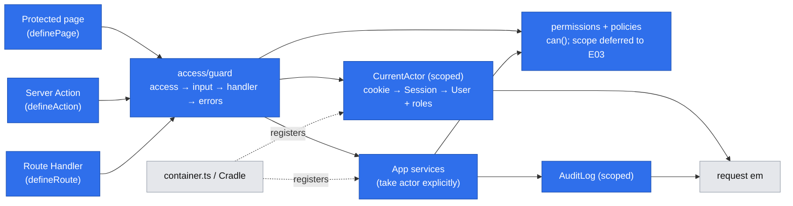
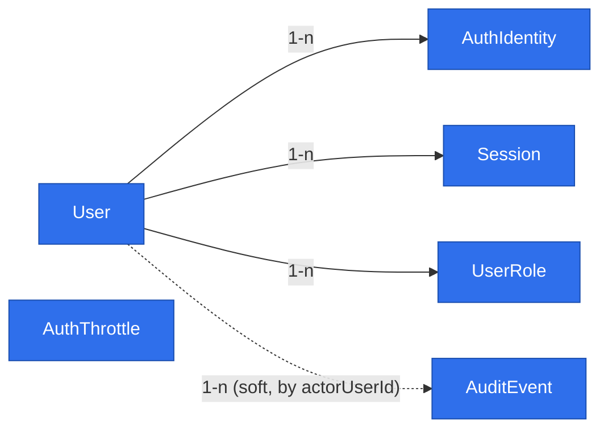

# Accounts and access (E01) and the access / entry-point primitives

Status: approved (2026-11-27, design review of PR #30; third revision plus pre-implement audit gaps)
PR: #30 · branch: `spec/accounts-and-access` · design-only; merges after PR #31 (discovery)
Decision record: `.ai/specs/research/decisions/D30-login-password-mentees-only.md` partially
supersedes R06/D07; active, approved by the product owner on 2026-11-27 (see Decisions in play).
Issues: #8 (E01), #13 (E01-S01), #14 (E01-S02)
Source: `.ai/specs/product-brief.md`, `.ai/specs/backlog.md`
Extends: `.ai/specs/implemented/2026-11-24-monorepo-foundation.md` (its step-3 follow-up "`/backend` authentication")
Follow-up spec (owed, Q6a): `domain-foundation` (Money, versioned operator settings, lifecycle helper, webhook idempotency), due before E02-S03

## 📝 TLDR

DevMentor has no accounts today: every page, including `/backend`, is public. **Proposed:** a
visitor signs in with GitHub or with email and password (D07/R06) and can sign out. Each user holds
a set of roles (everyone is a mentee; `mentor` comes from an invitation and `operator` from a CLI
grant), and every role reaches only its own pages and data (#13, #14). The change also delivers the
access layer that E02–E05 build on:
- a request-scoped **actor**;
- a **permission catalog** and **resource policies** (`can` now; list `scope` deferred to E03);
- **guarded entry points** (`defineAction`, `defineRoute`, `definePage`) sharing access checks,
  with separate lifecycles for rendering, public reads, OAuth and mutations;
- an **audit log**, an injectable **clock**, typed errors;
- the frontend side: the `ActionResult` form contract, Tailwind form primitives, a role-aware
  navigation registry, and 403/sign-in redirects.

## 📝 Problem Statement

- **#13 (E01-S01):**
  - GitHub sign-in lands the user signed in with their roles.
  - Email registration lets a user sign in.
  - Wrong credentials show an error and create no session.
  - After sign-out, protected pages redirect to sign-in.
- **#14 (E01-S02):**
  - A mentee is denied mentor and operator pages.
  - A mentor is denied *another mentor's* booking data. This is an ownership check, not a role
    check. **Moved to #20 (E03-S02)** (decision 1, 2026-11-27): there are no bookings in E01. This
    spec delivers the policy mechanism (`definePolicy` / `assertCan`); list `scope` arrives with
    its first consumer in E03-S02. #20 carries the
    end-to-end negative test.
  - An operator reaches operator pages.
- **Why the primitives belong in this spec.** About 15 stories in E02–E05 ask the same three
  questions: who is acting, may this role do this, and does this resource belong to them. Without
  one layer, each story hand-rolls the checks, and one missed ownership check is a data leak (former
  #14 AC2, now #20). Primitives below are limited to needs with a named consumer in the backlog:

  | Primitive (this spec) | Consumers in the backlog |
  |---|---|
  | Actor + session | every signed-in story |
  | Permission catalog (role gate) | E02-S01, E05-S01, E05-S02 (operator); E02-S02/S03/S04 (mentor) |
  | Resource policy `can` now; `scope` contract for E03 | #20 (former #14 AC2), E03-S02/S03 bookings, E04-S01 session screen, E04-S02 note, E05-S02 dispute |
  | Role grant hook | E02-S01 invitation → `mentor` (R07: no open mentor registration); E01 CLI → `operator` (D19) |
  | Audit log | E01 role grants and account takeover; E02-S01 invites; E03-S03 mentor-cancel case; E05-S01 bounds/fee; E05-S02 decision |
  | Clock | E01 session expiry and throttle; R14 2-hour rule, R09 24-hour rule, D18 2-week window, R15 booking-to-start |
  | `defineAction` + `ActionResult` + form primitives | every form: register/sign-in now; profile, prices, slots, booking, cancel, note decision, dispute later |
  | `defineRoute` | `/api/health` and the GitHub callback now; Stripe webhooks and Checkout return later |

  Money, versioned settings, lifecycles and webhook idempotency have consumers too (E02-S03,
  E03-S02–S04, E04-S02, E05-S01–S03), but they are not access concerns. Per Q6a they get their own
  `domain-foundation` spec.

## 📝 User stories

**US1: A mentee registers with email and password.**
- **Who:** a working developer with no GitHub account at hand, e.g. on a work laptop.
- **Situation:** they want to look around and later book a mentor.
- **Wants:** an account without linking GitHub.
- **Sees:**
  - `/register` (name, email, password with the "at least 12 characters" hint), then `/account`
    with their name, email and "password" as the sign-in method;
  - the hint "Your email is unverified. Switching to GitHub verifies it and permanently disables
    password sign-in. Mentor and operator roles require GitHub.";
  - in the header: Account and Sign out, no Mentor workspace or Operator.
- **System underneath:**
  1. Hits the `register:ip` bucket and normalizes the email.
  2. Hashes the password with argon2id.
  3. Creates `User` (unverified) and a password `AuthIdentity`, plus a `Session`.
  4. Commits the account and session transaction, then sets the session cookie and redirects to
     `/account` (the cookie has the `__Host-` prefix only when secure).
- **Next:** sign-out and sign-in with the same credentials. Later: the mentor list (E03-S01).
- **Delta:** Register and sign in · Duplicate email · Unverified account hint · Wrong password ·
  Attempt budget (including successes) · Sign out · Mentee opens mentor and operator pages.

**US2: An invited mentor signs in with GitHub for the first time and reaches `/mentor`.**
- **Who:** a senior engineer the founders invited (R07).
- **Situation:** they hold an invitation. In E01 the founders grant the role with the CLI; from
  E02-S01 on, accepting the invitation grants it.
- **Wants:** to get to their mentor workspace with the account they already have.
- **Sees:**
  1. Opening `/mentor` while signed out redirects to `/sign-in?next=/mentor`.
  2. "Continue with GitHub" leads to GitHub authorization.
  3. Before the grant: the 403 page on `/mentor`. After the grant: the `/mentor` placeholder and
     "Mentor workspace" in the header, without signing in again.
- **System underneath:**
  1. Stores state and the PKCE verifier in short-lived cookies.
  2. The callback clears them, verifies state and exchanges the code.
  3. Reads the primary verified email. Rule 5 creates a verified `User` and a GitHub identity, or
     rule 1 signs in an existing one.
  4. After the grant, `RoleService.grant(mentor)` (verified account only) writes a `UserRole` and
     the audit event `role.granted`.
  5. The next request reads the roles again.
- **Next:** profile (E02-S02), prices and slots (E02-S03), Connect (E02-S04).
- **Delta:** First GitHub sign-in · Return to the protected page · Role takes effect without
  re-sign-in · Mentee opens mentor and operator pages (before the grant) · No verified email,
  cancelled or failed handshake · Email already linked to another GitHub account.

**US3: A founder becomes the operator and opens `/backend`.**
- **Who:** one of the two founders (D19).
- **Situation:** a fresh environment. `/backend`, public until now, is now closed.
- **Wants:** to reach the operator dashboard.
- **Sees:**
  - Opening `/backend` signed out redirects to sign-in. After signing in with GitHub, without the
    role: the 403 page.
  - After the grant: the dashboard with health badges and "Operator" in the header.
  - With a password-only account, the CLI answers "sign in with GitHub first".
- **System underneath:**
  - Sign-in follows US2.
  - On the server, the founder runs `npm run user:role -- grant --email … --role operator`. The
    CLI loads the user on a forked `em`, refuses unverified accounts, writes a `UserRole` and an
    audit event (`actorLabel = cli:<osUser>`), and exits 0.
  - `definePage({ access: "operator.backend" })` then lets them in.
- **Next:** operator stories E02-S01 (invitations) and E05.
- **Delta:** Anonymous visitor · Operator · Operator opens operator pages · Role refused for an
  unverified account.

## 📝 Proposed Solution

**Auth as our own module on small libraries (Q1a).**
- Arctic `OAuth2Client` handles GitHub OAuth (state + PKCE S256), with endpoints configurable so
  tests can point it at a fake server.
- `@node-rs/argon2` (argon2id) hashes passwords.
- **Database sessions** are MikroORM entities: an opaque random token in an httpOnly cookie, with
  only its SHA-256 hash stored.

Sessions are revocable and roles are read from the database on every request. A role granted by an
invitation or the CLI therefore takes effect on the next request without signing in again.
Access checks run at entry points, and resource checks live in application services next to data
access. A wrapper or a hidden menu item is not a substitute for an ownership check.

**One rule for every entry point.** A Server Action, Route Handler or protected page exists only as
one of three things:
- `defineAction(...)`;
- `defineRoute(...)`;
- `definePage(...)` (for pages).

Each one declares its `access` explicitly (`"public"`, `"signed-in"` or a permission); there is no
default. An architecture unit test enforces this (see Testing).

**Alternatives that lost:**
- *A full auth framework*: Q1a chose a small custom module integrated with MikroORM and our
  migration lifecycle. This is an accepted maintenance cost, not a claim that another framework
  cannot use repository-owned migrations. Re-evaluate actual adapters if Q1a changes.
- *Auth.js*: its credentials provider forces JWT sessions and discourages passwords.
- *Purely stateless JWT sessions*: revocation and fresh roles require additional server-side
  state/checks; database sessions already provide the state this application needs.
- *`proxy.ts` optimistic redirects*: optional per the Next docs and a second place for auth logic.
  The page guards already meet #13 AC4. Proxy can be added later as a pure optimization.
- *Role checks scattered as `if (user.role === …)`*: the gap the policy layer closes.

## 📝 Architecture

The wrappers share access checks, not one execution pipeline. Mutating services own their short
database transactions; HTTP adapters write cookies only after commit. Public routes do not
implicitly resolve an actor or EntityManager. Services receive actors explicitly and enforce
resource policies; list scoping is implemented with the first owned-resource list in E03-S02.

### Package placement (keeps the dependency direction)

| Package | New code |
|---|---|
| `core` | `errors.ts`: new `UnauthorizedError` 401, `ForbiddenError` 403, `ConflictError` 409, `RateLimitedError` 429; the existing `NotFoundError` 404 (used by `assertCan`) and `ValidationError` 400 stay. `clock.ts`: `Clock { now(): Date }`, `systemClock`, `fixedClock(date)` for tests. `action-result.ts`: `ActionResult<T>`, `ok()`, `fail()` (framework-agnostic types, shared by app and ui). `redirect-target.ts`: `safeRedirectPath(value, fallback)`, which rejects `//`, `/\`, absolute URLs and control characters (open-redirect guard). |
| `db` | Entities `User`, `AuthIdentity`, `Session`, `UserRole`, `AuditEvent`, `AuthThrottle` + one migration. Generic data helper `hashToken(token)` (sha-256 hex) in `helpers.ts`. No business rules here. |
| `app/src/server/auth/` | `password-hasher.ts` (argon2id behind a `PasswordHasher` interface), `session-service.ts`, `auth-cookies.ts` (the only module calling `cookies()`: the session cookie and the three OAuth transaction cookies), `github-oauth.ts` (uses `auth-cookies.ts`), `client-ip.ts` (see Throttle), `account-service.ts` (register / password sign-in / GitHub resolve-or-link), `throttle-service.ts`, `auth-config.ts` (env parsed once with zod). `src/instrumentation.ts`: `register()` validates `auth-config` at server start (see Configuration validation). |
| `app/src/server/access/` | `actor.ts` (`Actor` type, `CurrentActor` scoped service), `roles.ts`, `permissions.ts` (catalog), `policy.ts` (`definePolicy`), `policies/user.ts`, `guard.ts` (`defineAction`, `defineRoute`, `definePage`, `requireActor`, `requirePermission`), `role-service.ts` (grant/revoke + audit), `audit-log.ts`. |
| `app/src/cli/` | `user-role.ts`: `npm run user:role -- grant\|revoke --email <e> --role mentor\|operator` (Q3a); `auth-cleanup.ts`: bounded retention cleanup. Both load root env before ORM initialization and close the pool in `finally`. |
| `app/src/app/` | `(frontend)/sign-in`, `(frontend)/register`, `(frontend)/account`, `(frontend)/mentor`, `api/auth/github/route.ts` (start), `api/auth/github/callback/route.ts`, `forbidden.tsx`, `(frontend)/_components/form/*`, `(frontend)/_components/site-header.tsx`, `src/navigation.ts`. `/backend` becomes operator-only. |

`next.config.ts` adds `experimental.authInterrupts: true` (needed by `forbidden()`) and adds
`@node-rs/argon2` to `serverExternalPackages` (native addon). New dependencies:
- `@devmentor/app`: `arctic`, `@node-rs/argon2`, `zod` (Q7a), plus `tsx` for the CLI; move
  `@next/env` from devDependencies to dependencies for the CLI's root-env loader.
- `@devmentor/core`: none.

### Actor and session

- `type Actor = { kind: "anonymous" } | { kind: "user"; userId; email; emailVerified; name; roleNames: readonly Role[]; permissions: ReadonlySet<Permission> }`.
  `type Role = "mentee" | "mentor" | "operator"`.
  - Every signed-in user has `mentee` implicitly. It is not stored (Q2a).
  - Only `mentor` and `operator` are stored, as `UserRole` rows.
  - `permissions` is computed once from the catalog when the actor is resolved. `roleNames` is for
    display only. Authorization code calls `hasPermission(actor, p)` and never branches on role
    names.
- `CurrentActor` (scoped) exposes `get(): Promise<Actor>`, memoized per request scope. It reads the
  session cookie and then makes **one** query: session JOIN user LEFT JOIN stored roles, filtered by
  `expiresAt > clock.now()`.
  - **It is read-only.** It neither writes cookies nor changes rows. It runs during Server Component
    render, where Next 16 forbids setting cookies (`cookies.md`, "Setting cookies is not supported
    during Server Component rendering"), and pages never flush.
  - An invalid, expired or unknown token returns anonymous.
  - A database or configuration error **propagates** from `get()`, so guards fail closed.
    `getForDisplay(): Promise<Actor>` is the only fail-open path: it returns anonymous and logs
    the error (without token or email). Only the site header uses it; menu visibility is not an
    authorization boundary, so public pages keep rendering when the database is down.
  - The expiry is a fixed 30 days, with no sliding refresh. Sign-in may delete a user's expired
    sessions within its transaction; periodic cleanup also removes sessions of users who never
    sign in again (see Retention).
- Cookie `dm_session` (`__Host-dm_session` when secure): `httpOnly`, `sameSite=lax`, `path=/`,
  `maxAge` = session lifetime.
  - `secure` is on unless `APP_URL` is plain http on a loopback host (localhost / 127.0.0.1, which
    covers local dev and e2e).
  - With `NODE_ENV=production`, a non-loopback http `APP_URL` is a startup configuration error, so
    a misconfigured production cannot fall back to non-secure cookies.
  - A new token is created on every sign-in (no session fixation).
  - Sign-out deletes the row and the cookie.
  - Cookies are written only from Server Actions and Route Handlers, never from page render.
- Services never call `cookies()`. They take `actor` as a method argument from the guard, which
  keeps them unit-testable without Next mocks.

### Permission catalog and policies

- `permissions.ts` maps each role to the permissions it grants. E01 defines only what E01 uses:

  | Permission | Granted to | Used by |
  |---|---|---|
  | `account.self` | mentee (every user) | `/account`, sign-out |
  | `mentor.workspace` | mentor | `/mentor` (E02 pages extend it) |
  | `operator.backend` | operator | everything under `/backend` |

  Later specs add their permissions to this one file. `hasPermission(actor, permission)` is the
  role-area check; resource access additionally uses a policy. `roleNames` is display-only.
- `definePolicy<R>({ name, can(actor, action, resource): boolean })`.
  - Ownership checks for loaded resources go through `can`.
  - `assertCan(policy, actor, action, resource)` throws `NotFoundError` for a resource the actor may
    not see. It returns 404 rather than 403, so id probing cannot reveal that another mentor's
    booking exists.
  - E01 ships the `User` policy: `read` on self; operator reads anyone. `/account` loads the user
    through it, so the mechanism has a real consumer in E01.
  - Bookings, sessions, notes and disputes add their own policies in their specs. AGENTS.md
    (Phase 5) makes a negative test for every owned-resource policy mandatory.
  - **Deferred to E03-S02:** add `scope(actor, action): FilterQuery<R> | "none"` with its first
    real list consumer, not an unused implementation in E01. The future contract combines scope
    and caller filters through logical AND, never object spread; `"none"` returns an empty list
    without querying. Tests must prove caller filters cannot overwrite ownership and `can` and
    `scope` agree. Until then, E01 `/account` loads the actor's user and applies `assertCan`.

### Guarded entry points

- `defineAction({ access, input, handler })` returns `(prev: ActionResult<T>, formData: FormData) => Promise<ActionResult<T>>`,
  ready for `useActionState`. Order of steps:
  1. for protected access, resolve the request container and actor and check access; a public
     action does not resolve either until its handler explicitly needs them;
  2. reject an access failure before calling the handler;
  3. parse `formData` with the zod `input` schema;
  4. run `handler({ input, actor, cradle? })`, which returns `ActionOutcome<T> = { data: T } | { redirectTo: string }`;
     protected actions receive the already-resolved scoped cradle; public actions get an anonymous
     actor and no cradle, and resolve one scope explicitly if needed. Reuse that scope throughout
     the handler/service transaction; do not rely on React cache to deduplicate Route Handler calls;
  5. the handler awaits its service's commit, then uses the cookie adapter if required;
  6. outside the error-mapping `try/catch`, call `redirect(safeRedirectPath(redirectTo, "/account"))`
     or return `ok(data)`. The guard never calls `em.flush()`.

  Handlers return outcomes instead of throwing redirects. Registration/sign-in services return a
  committed session `{ token, expiresAt }` to the HTTP adapter; the raw token is never included in
  `ActionResult`, logged or passed to client components. The adapter then sets the cookie and
  returns the redirect outcome. Sign-out commits deletion before deleting its cookie.

  **Transaction boundary.** Mutating application services own a short explicit transaction on
  their request-scoped EM. All dependent database writes, including `nativeDelete` and the audit
  event, use that transactional EM and commit together. Other services participating in the
  operation use the same EM; do not build a second request container or independently commit an
  audit write. Services must not leave pending changes for a guard to flush. There is no transaction
  around rendering, HTTP-only handlers, OAuth network calls or password hashing. A recording EM
  tests ordering; real PostgreSQL integration tests prove rollback and concurrency.

  Error mapping does not itself undo work. A failure before commit rolls back the service's
  transaction. A cookie/response failure after commit cannot undo committed business changes:
  return a generic error, never claim rollback, and let the user retry sign-in. A failed cookie
  write may leave an unreachable session until expiry/cleanup; authorization still requires a
  valid committed session.
  - `ZodError` → `fail("validation_error", fieldErrors)`.
  - `AppError` → `fail(code, message)`.
  - All Next control-flow errors, including `redirect()`, `forbidden()` and `notFound()`, are
    rethrown (`unstable_rethrow`) if encountered; they are never mapped to `internal_error`.
  - Anything else is logged server-side and returned as `fail("internal_error", "Something went wrong")`,
    with no internal details.
  - An access failure in an action returns `fail("unauthorized" | "forbidden")`; the form shows a
    sign-in link.

  Throttle counters must survive a failed action. `ThrottleService` uses a separate fork/connection
  in autocommit mode for each atomic statement, outside any business transaction.
- `defineRoute({ access, input?, handler })` shares access checks and safe error mapping, not
  automatic transaction/flush behavior. Public routes resolve no container or actor by default;
  a handler can resolve one scope explicitly. Protected routes receive the checked actor and the
  already-resolved scoped cradle; all participating services reuse that scope.
  The handler returns
  either a `Response` (redirects, `Set-Cookie`, custom status and headers, e.g. `/api/health`'s
  503 and `no-store`) or plain data, which is serialized as JSON with status 200. An `AppError`
  maps to `{ error: { code, message } }` with its `status`; unexpected errors return a generic 500.
  OAuth protocol errors are handled by the callback adapter as redirects, before generic mapping.
  `/api/health` delegates to the existing `getHealthReport()` fallback and returns 200/503 JSON
  with `no-store`, even if DB initialization fails or a request carries a stale session cookie.
  There is no extra session query or flush before or after the health handler.
  - **Deferred Origin guard:** E01 has only GET Route Handlers. The first cookie-authenticated
    non-GET/HEAD route adds a tested Origin check against `APP_URL` before mutation; missing or
    mismatched Origin returns 403 `bad_origin`. Authorization (`public`/permission) is not the
    same as authentication/CSRF mechanism: a future public login route also needs login-CSRF
    protection, while a webhook uses signature verification. E01 Server Actions use Next's Origin
    checks; `sameSite=lax` is not the complete CSRF defense.
- `definePage({ access, returnTo }, Page)` wraps every page's default export. For protected pages,
  `returnTo` is required: a safe route-local path or a function of page `params`/`searchParams`.
  There is no implicit `pathname` in Server Component page props. Public pages omit `returnTo`.
  The wrapper runs
  `requireActor` / `requirePermission` before rendering and passes `actor` to the page:
  - anonymous on a protected page → redirect to `/sign-in` with `next` encoded through
    `URLSearchParams`, after `safeRedirectPath(returnTo, "/account")`; this preserves `&`, `?`
    and fragments in an internal return path;
  - signed in but lacking the permission → `forbidden()` (403, `forbidden.tsx`).
  - Applied per **page**, not in the layout. Layouts do not re-run on client navigation, so a
    layout-only guard is not enough.
  - Protected page guards finish before response streaming; do not place the guard behind
    `loading.tsx`/Suspense that streams the protected segment first. E01 direct HTTP requests for
    denied pages must return 403. Nested component checks still deny data if streaming has already
    started, but can then render the forbidden UI with HTTP 200, as Next documents; do not promise
    a new status after headers have been sent.
  - `requireActor` / `requirePermission` stay exported for Server Components nested inside a page.
    Public pages use an anonymous actor by default; the header resolves the actual actor separately.
- **Brand and architecture test.** `defineAction`, `defineRoute` and `definePage` results carry a
  `GUARDED` brand symbol as a convention check, not proof of authorization. Static AST/lint checks
  cover all `packages/app/src` sources (excluding test fixtures), not only the route directory;
  focused unit tests check factory behavior/brands without importing every route/page dynamically:
  - every module with a module-level `"use server"` directive (any file name) exports only
    branded functions;
  - every `route.ts` exports only branded HTTP-method handlers plus the allowlisted segment-config
    names (`dynamic`, `revalidate`, `runtime`, `maxDuration`, `fetchCache`, `preferredRegion`);
  - every `page.tsx` default export is branded;
  - inline `"use server"` directives are rejected through AST inspection, not grep. Actions live in modules;
  - no module except `server/auth/auth-cookies.ts` imports `cookies` from `next/headers`.

### Account flows

- **Register** (`(frontend)/register`, action `access: "public"`):
  - Fields: name (1–100 chars), email (normalized: trimmed and lower-cased), password (12–128 chars,
    no composition rules, per NIST 800-63B).
  - An existing email gives `ConflictError`: "An account with this email already exists. Sign in
    instead." Q4a has no email channel, so the existence of an email cannot be hidden here; sign-in
    stays generic.
  - On success: create `User` + password `AuthIdentity`, create a session, and return
    `{ redirectTo: next ?? "/account" }`.
  - Throttled per client IP: 10 registrations per hour (see below).
- **Password sign-in:**
  - Every failure gives the same message, "Email or password is incorrect", and no session.
  - When no user is found, the action still verifies against a dummy hash, so response time does
    not reveal which emails exist.
  - Fetch and verify the password hash outside a transaction. On success, start a short
    transaction, lock the `User` row (`FOR UPDATE`), re-read the password identity and check that
    its hash still matches the one just verified. If it was removed/replaced, return generic
    `invalid_credentials` and create no session. Create the session under that same lock.
    GitHub claims and credential changes acquire the same user lock before deleting credentials
    or sessions. A sign-in that commits first is invalidated by a subsequent claim; a claim that
    commits first prevents the stale password request from issuing a new session. Do not hold a
    database lock during argon2.
  - Throttle (`ThrottleService`, buckets in `AuthThrottle`). Each `hit(key, limit, window)` is one
    atomic `INSERT … ON CONFLICT (key) DO UPDATE … RETURNING` and commits immediately, so
    parallel requests cannot slip past the limit and a failed action cannot drop the count. The
    buckets:

    | Bucket | Limit |
    |---|---|
    | `signin:ip:<ip>` | 20 attempts / 15 min |
    | `signin:email-ip:<email>:<ip>` | 5 attempts / 15 min |
    | `signin:email:<email>` | 50 attempts / hour; slows distributed guessing |
    | `register:ip:<ip>` | 10 / hour |

    - After input validation, consume the IP, email-IP and email buckets before password verification.
      The first increment above a limit returns `RateLimitedError` ("Too many attempts, try again
      later") without running argon2. All attempts, including successes and unknown emails, consume
      the budget. Do not reset counters on success; only elapsed windows reset them. This avoids
      success/failure races and bounds parallel argon2 work. Registration consumes its bucket
      before hashing too.
    - Shared IPs and the broad email bucket can still lock out legitimate users; this is an accepted
      abuse/availability trade-off, not a claim that lockout is impossible. GitHub sign-in is never
      throttled by the password buckets.
    - **Client IP** (`client-ip.ts`), set by `TRUSTED_PROXY_HOPS` (integer, default `0`):
      - The App Router does not expose the socket. Next's server fills `x-forwarded-for` with the
        socket address only when the request has no such header (`base-server.js`, `??=`).
      - For `h > 0`, parse a comma-separated chain of valid IP addresses and select
        `entries[entries.length - h]`. Every trusted proxy appends the peer it saw. Examples:
        `h=1`, `spoof, client` → `client`; `h=2`, `spoof, client, proxy1` → `client`.
        Missing/invalid headers or fewer than `h` entries give `ValidationError` (`invalid_client_ip`)
        before hashing; never fall back to a client-controlled leftmost entry. Canonicalize IPv4,
        IPv6 and IPv4-mapped IPv6 consistently before constructing keys.
      - Deployment must block direct app ingress and pin the actual appending-proxy topology.
        The edge proxy strips untrusted forwarding metadata or constructs a canonical chain;
        count-based parsing is safe only under that deployment contract.
    - `h = 0` is local dev only: use a fixed `local-dev` bucket, ignoring supplied XFF. App Router
      cannot independently authenticate the socket address. Under `NODE_ENV=production`, `h = 0`
      is a startup error even for loopback `APP_URL`; production-build e2e runs behind its one
      forwarding proxy with `h=1`. Do not infer network trust from APP_URL alone.
- **GitHub sign-in:**
  - Before every GitHub button on `/sign-in`, `/register` (if present) and `/account`, show:
    "If this email has an unverified password account, continuing with GitHub permanently disables
    its password and ends its existing sessions. Use GitHub to sign in afterwards." Clicking the
    labeled button is the explicit choice; the warning remains visible when retrying a failed flow.
    E01 keeps this conversion behavior for all roles, including mentees; it does not silently
    preserve an unverified password during recovery.
  - `GET /api/auth/github?next=…` (public) creates state and a PKCE verifier and stores them plus
    `next` in 10-minute cookies: httpOnly, `sameSite=lax` (strict would drop them on the
    cross-site return from GitHub), `path=/api/auth/github`. It then redirects to
    `{GITHUB_OAUTH_URL}/login/oauth/authorize` with scope `read:user user:email`. These cookies use
    the same secure decision as the session cookie (without `__Host-` because their path differs).
    The state cookie stores the nonce and optional initiating user id. The adapter explicitly
    resolves the current actor for this binding; the public route guard does not do it implicitly.
  - `GET /api/auth/github/callback` always clears the three OAuth cookies first. It then checks
    the protocol response/state, exchanges the code, and fetches `/user` and `/user/emails`, all
    before starting a database transaction. A valid `error=access_denied` response returns
    `/sign-in?error=github_cancelled`; missing/mismatched state, malformed responses or missing
    cookies return `github_failed`. No required-code parser may intercept the error response and
    return JSON 400 instead. State/cookie validation also applies to cancellation.
    If a user initiated conversion while signed in, the callback must still have that actor and
    GitHub must resolve to that same user (matching verified email for a new link). If the GitHub
    id or email belongs to a different user, return `github_conflict`. If it belongs to no user
    but its primary verified email differs from the initiating user's email, redirect to
    `/account?error=github_email_mismatch` ("Your GitHub account's primary verified email doesn't
    match this account's email. Make it your primary verified email on GitHub, then try again.";
    GitHub's email is not echoed). Neither case changes any account. Linking a different email
    is not offered in E01. This distinguishes authenticated
    conversion of one's own account from anonymous recovery/claim and prevents accidental account
    switching. A lost initiating session returns `github_failed` and requires a fresh flow.
    It resolves the account in
    this order:
    1. A GitHub identity with that GitHub id exists → sign in as that user.
    2. No **primary verified** email → back to `/sign-in?error=github_no_verified_email`.
    3. The email matches a user who already has a GitHub identity with a different id → back to
       `/sign-in?error=github_conflict` ("This email belongs to an account linked to another
       GitHub account").
    4. The email matches a user **without a GitHub identity** (password-only, always unverified
       under Q4a): **GitHub converts/claims the account**. In one explicit transaction this links GitHub, deletes the password identity, deletes all of
       that user's sessions, revokes every role it holds, marks the email verified, writes the
       audit event `account.claimed_by_github`, and shows a notice on `/account` ("Password sign-in
       was turned off because your email was never verified; use GitHub").
       - Revoking roles matters only if a future story grants roles to unverified accounts. In E01
         `RoleService` refuses that, so this is defence in depth.
    5. Otherwise → create a user with `emailVerifiedAt = now` and a GitHub identity. `name` is
       GitHub's `name`, or the GitHub login when that is null or empty.
  - **Profile data on later sign-ins:** every GitHub sign-in refreshes `githubLogin` on the
    identity. `User.name` is set once at creation and is not overwritten. `User.email` is never
    re-synced from GitHub in E01: syncing would collide with the unique constraint and the claim
    rules (3–4). Email changes come with a later profile/verification story.
  - Lock the target User row, re-check identity/email resolution under that lock, perform the
    resolution and create the new session in the same transaction. Rule 1 uses stable GitHub id;
    it does not require a returning identity to have a currently verified primary email.
    For new users, UNIQUE email/provider-subject constraints arbitrate concurrent creation.
    After a uniqueness conflict, roll back and re-read on a fresh transaction: reuse the same
    identity or return `github_conflict`/registration `conflict`, never leak a SQL error. Bound
    retries; persistent unexpected database failures remain generic errors.
  - After commit, set the new session cookie, then return 302 to `safeRedirectPath(next, "/account")`.
    The account-claim notice is derived from its latest `account.claimed_by_github` audit event;
    show it only when present within audit retention, not as a new user flag.
  - A state mismatch, missing cookies or a GitHub error leads back to `/sign-in?error=github_failed`,
    with no session.
- **Sign-out:** a Server Action (`access: "signed-in"`, POST; Next checks the Origin of Server
  Actions). It deletes the session and redirects to `/`.
- **Password reset (Q4a): GitHub sign-in is the only recovery.**
  - A user who forgot their password signs in with a GitHub account whose verified primary email
    is the same. Rule 4 claims the account: password sign-in ends and GitHub becomes the sign-in
    method.
  - There is no CLI path and no reset screen. The earlier "operator deletes the password identity
    and the user registers again" path is dropped: the `User` row would remain, so registration
    would conflict.
  - Consequence (accepted under Q4a): a mentee without a GitHub account under that email cannot
    recover the account in 1.0. They can register under another address. Email verification and
    reset come with Q4b if this hurts.

### Roles, operator bootstrap, audit

- `RoleService.grant(userId, role, { by })` / `revoke(...)` is idempotent (granting twice is a
  no-op). Each change writes `role.granted` / `role.revoked` to the audit log. Role operations use
  a short explicit transaction and the target User lock; concurrent identical grants/revokes
  produce one actual change and one audit event, not an unhandled uniqueness error. Audit writes
  use the operation's transactional EM. CLI and invitation adapters await commit.
  - `grant` **refuses an account whose email is unverified** (`ForbiddenError`
    "unverified_account"). Under Q4a only GitHub verifies an email. Otherwise someone who registers
    a founder's or an invited mentor's email first would receive the role.
  - Consequence (decision 2, 2026-11-27): **mentor and operator roles require at least one GitHub
    sign-in, and the password fallback applies to mentees only.** A role holder can never have a
    password identity:
    - only verified accounts receive roles;
    - only GitHub verifies an email (Q4a);
    - the GitHub claim (rule 4) deletes the password identity;
    - there is no set-password flow;
    - registering with a GitHub account's email conflicts.

    This is a **conscious partial deviation from D07**, which offers the email/password fallback to
    every role, recorded as D30 (active). See Decisions in play.
  - **Note for E02-S01 (invitations):** an invited mentor must sign in with GitHub before accepting.
    The acceptance step checks `actor.emailVerified`, and otherwise shows "Sign in with GitHub to
    accept this invitation" with the GitHub button (`next` set to the invitation link).
  - E02-S01 calls `grant(mentor)` when a mentor accepts an invitation.
  - The CLI calls it for operators (Q3a), with `by = { kind: "cli", osUser }`.
- CLI `npm run user:role -- grant --email a@b --role operator`:
  - Runs `tsx --conditions=react-server src/cli/user-role.ts`. The condition turns `server-only`
    into a no-op outside Next.
  - Uses `orm.em.fork()` and the same `RoleService` / `AuditLog`.
  - Loads root `.env.local` with `@next/env` before `getOrm()` (same ESM interop convention as the
    MikroORM CLI), commits the role and audit together, and calls `closeOrm()` in `finally` on
    success and failure. Do not import request/cookie composition into the CLI.
  - Exit code 1 with a message for an unknown email or role, or for an unverified account ("sign in
    with GitHub first"). The user must sign in with GitHub first.
  - `tsx` is a regular **dependency** of `@devmentor/app`, so the CLI also works on a production
    install (`npm ci --omit=dev`); the env loader is a runtime dependency too. Verify both grant
    and failure exit paths on that installation, including process termination without a live pool.
- `AuditLog.record({ actor, action, subject: { type, id }, data? })` persists an `AuditEvent` in the
  same unit of work as the change.
  - This is the in-product record of actions taken through the product.
  - R18's shared operator note stays the record for actions done **outside** the product. E05-S01
    may later add an operator view of the log.
  - No PII beyond ids goes into `data`; emails live on `User`.
  - `action` is a typed `AuditAction` union (E01: `role.granted`, `role.revoked`,
    `account.claimed_by_github`). Later specs extend the union and must pick a retention for each
    new action in the same change (see Retention).

### Retention

- `npm run auth:cleanup` loads root env, uses a forked EM and closes ORM in `finally`. A scheduled
  deployment command runs it daily; no new job framework. Each run deletes at most 10 batches
  of 1,000 rows per table and reports counts only, without IP/email values. Failed runs retry
  next day; operations are idempotent. Configure deployment scheduling before production rollout.
- Remove sessions expired for at least 24 hours; index `expiresAt`. Remove throttle rows whose
  last window started over 48 hours ago (maximum auth window is one hour); index `windowStartedAt`.
  This also cleans keys for nonexistent users. Password success never deletes a throttle row.
- Audit retention is set **per action** in one map in `audit-log.ts`:
  `AUDIT_RETENTION: Record<AuditAction, { days: number } | "forever">`. Typecheck forces every new
  action to choose; there is no runtime default. E01 values:

  | Action | Retention |
  |---|---|
  | `account.claimed_by_github` | 90 days |
  | `role.granted`, `role.revoked` | `forever` (low volume; answers "who made X an operator, and when") |

  Cleanup deletes only actions with a `days` value, past their cutoff. No application updates or
  ad hoc deletes, only this privileged retention path. Later families (E05-S01 fee/bounds,
  E05-S02 disputes) choose their retention in their own specs. The existing `createdAt` index
  supports deletion; add (`action`, `createdAt`) if a query plan needs it. User ids and CLI labels can
  still be personal data; "no emails" does not make the log anonymous. Account-claim notices
  are explanatory and expire with the event; loss of an old notice does not affect auth.

## 📝 Data Model

All entities use `defineEntity` + `p`, are registered in `entities/index.ts`, and ship in one
migration (`--name accounts-and-access`) with the snapshot.

| Entity (table) | Fields | Constraints / notes |
|---|---|---|
| `User` (`user`) | `...baseProperties`, `email` text, `emailVerifiedAt` datetime?, `name` text | unique `email` (stored normalized). |
| `AuthIdentity` (`auth_identity`) | `...baseProperties`, `user` → User, `provider` enum `github \| password`, `subject` text (GitHub numeric id / normalized email), `secretHash` text? (argon2id PHC string, password only), `githubLogin` text? | unique (`provider`, `subject`); unique (`user`, `provider`); `on delete cascade` from user. |
| `Session` (`session`) | `id` text PK = sha-256(token) hex, `user` → User, `expiresAt` datetime, `createdAt` datetime | indexes `user`, `expiresAt`; cascade from user. No `baseProperties` (the PK is the token hash, and there is no `updatedAt` churn). |
| `UserRole` (`user_role`) | `...baseProperties`, `user` → User, `role` enum `mentor \| operator` | unique (`user`, `role`); cascade from user. `mentee` is implicit. |
| `AuditEvent` (`audit_event`) | `id` uuid, `createdAt`, `actorUserId` uuid? (null for CLI/system), `actorLabel` text (`user` / `cli:<osUser>` / `system`), `action` text, `subjectType` text, `subjectId` text, `data` jsonb? | Append-only until scheduled per-action retention deletion, no FK to user (survives user deletion within retention), index (`subjectType`, `subjectId`), index `createdAt`. Retention per action (`AUDIT_RETENTION`); `role.*` kept forever. |
| `AuthThrottle` (`auth_throttle`) | `key` text PK (e.g. `signin:email-ip:<email>:<ip>`), `count` int, `windowStartedAt` datetime | Atomic upsert counts attempts and resets elapsed windows; index `windowStartedAt`. No reset on success; scheduled cleanup removes stale keys. |

Sensitive data:
- Passwords exist only as argon2id hashes.
- Session tokens exist only as SHA-256 hashes; the raw token lives only in the cookie.
  Generate at least 32 cryptographically random bytes for each token; the raw value is transient
  server memory only until the post-commit cookie write.
- GitHub access tokens are used once to read profile and emails and are **not stored**.
- No email addresses in audit `data` or logs.

No existing entities: the schema has only `baseProperties` today. `AuthThrottle` stands alone, with one
row per throttle bucket key (IP, email + IP, or email; see Account flows).

## 📝 API Contracts

| Entry | Access | Input (zod) | Result |
|---|---|---|---|
| `registerAction` | public | `name`, `email`, `password`, `next?` | redirect / `fail(validation_error \| conflict \| rate_limited)` |
| `signInAction` | public | `email`, `password`, `next?` | redirect / `fail(invalid_credentials \| rate_limited \| validation_error)` |
| `signOutAction` | signed-in | — | redirect `/` |
| `GET /api/auth/github` | public | `next?` | 302 to GitHub; sets `dm_oauth_state`, `dm_oauth_verifier`, `dm_oauth_next` |
| `GET /api/auth/github/callback` | public | success `{code,state}` or provider error `{error,state?,error_description?}`; adapter also handles missing/malformed values | always clear transaction cookies; 302 to safe `next` after commit, or `/sign-in?error=github_cancelled\|github_failed\|github_no_verified_email\|github_conflict`; same-user conversion with a different GitHub email → `/account?error=github_email_mismatch` |
| `GET /api/health` | public | — | unchanged body; now built with `defineRoute` |

`invalid_client_ip` is a validation error on register/password actions. Unexpected action errors
return `internal_error`; no raw database/provider details. Callback protocol parsing belongs to
the adapter so malformed or cancelled responses take the defined redirect path. When GitHub is
unconfigured, both OAuth routes return 404 (callback also clears transaction cookies).
CLI `user:role` accepts only grant/revoke, normalized email and mentor/operator; exits 0 on a
change or idempotent no-op, 1 for validation/domain/database failure. `auth:cleanup` accepts no
arguments; exits 0 with deletion counts, 1 on invalid arguments/database failure.

`ActionResult<T> = { ok: true; data: T } | { ok: false; error: { code: string; message: string; fieldErrors?: Record<string, string[]> } }`.

Env vars (in `.env.example`, server-only, loaded and validated by `auth-config.ts`):

| Variable | Notes |
|---|---|
| `APP_URL` | Default `http://localhost:3000`. Builds the redirect URI `${APP_URL}/api/auth/github/callback` and decides the `secure` cookie flag. |
| `GITHUB_CLIENT_ID`, `GITHUB_CLIENT_SECRET` | Optional. When missing, the GitHub button is hidden and the start route returns 404. Email and password still work, and `npm run setup` still yields a working app, but nobody can reach `/backend` or `/mentor` (roles need a GitHub-verified email). Local developers create a personal GitHub OAuth app with callback `http://localhost:3000/api/auth/github/callback`; the `npm run setup` output and `developer-setup` explain how. In a sandbox preview, set `APP_URL` to the preview origin and register that origin's callback in the OAuth app. No unverified-grant bypass exists. |
| `GITHUB_OAUTH_URL` (default `https://github.com`), `GITHUB_API_URL` (default `https://api.github.com`) | Test overrides used by e2e. |
| `TRUSTED_PROXY_HOPS` | Default `0` for local dev's fixed bucket. Positive integer for deployed/production-build apps; `0` under `NODE_ENV=production` is a startup error. Number of trusted appending proxies, with direct app ingress blocked. |

## 📝 UI/UX

All signed-in mentor and mentee screens are **frontend** (Tailwind, Q5b). `/backend` (shadcn) is
operator-only.
- **Site header** (frontend, Server Component). It reads the navigation registry (`src/navigation.ts`:
  `{ href, label, access }[]`) filtered by `hasPermission(actor)`.
  Later epics add items to the registry instead of editing headers.
  - The header resolves the actor with `CurrentActor.getForDisplay()`. If the lookup fails, it
    renders the anonymous menu, so `/` and other public pages still render with the database
    down (today's frontend layout is DB-free). Protected pages still fail closed through their
    guards. Reading the session cookie makes frontend pages dynamic; this is intended.
  - Anonymous: "Sign in" and "Register".
  - Signed in: "Account", "Mentor workspace" (mentor), "Operator" (operator → `/backend`), and a
    "Sign out" button form.
  - CLI grants/revokes affect the next server request, but a persistent layout header can remain
    stale in an already-open tab. Reload/full navigation updates the menu; no polling or real-time
    channel in E01. Server guards still check every protected request. Test both a fresh request
    and client navigation after revocation; menu visibility is not an authorization boundary.
- **`/sign-in`:**
  - "Continue with GitHub" as the primary action (D07). It is a link to the start route and is
    hidden when GitHub is not configured.
  - Show the irreversible-conversion warning from Account flows immediately before the button;
    email/password users see the consequence before choosing GitHub, not only after conversion.
  - A divider, then the email/password form.
  - The `?error=` codes map to human messages.
  - An already signed-in visitor is redirected to `/account`.
    Because this is a public page, resolve `CurrentActor` explicitly inside `/sign-in` and
    `/register` for this redirect; do not assume their public wrapper supplied a signed-in actor.
- **`/register`:** name, email, password, with "at least 12 characters" hint text.
- **`/account`** (`account.self`): name, email, sign-in methods (GitHub login / password), roles,
  and the GitHub-claim notice when it applies.
  - `?error=github_email_mismatch` shows the mismatch message from Account flows above the
    "Switch to GitHub" button.
  - **Unverified-account hint** (password-only users): "Your email is unverified. Switching to
    GitHub verifies it and permanently disables password sign-in. Mentor and operator roles
    require GitHub." Show the full conversion warning and label the button "Switch to GitHub"
    (`next=/account`). Hide the button when unconfigured; say "GitHub sign-in is unavailable here"
    rather than directing the user to an absent provider.
- **`/mentor`** (`mentor.workspace`): an empty workspace placeholder ("Profile, prices and slots
  come next", replaced by E02-S02).
- **`forbidden.tsx`:** "You don't have access to this page", with a link home. E01 direct denied
  page requests return 403 because their guard completes before streaming; a later nested denial
  after streaming may display the same UI with 200. No protected fields render in either case.
- **Frontend form primitives** (`(frontend)/_components/form/`, client, Tailwind only):
  - `ActionForm` wraps `useActionState(action, initial)`.
  - `Field`: label, input, `fieldErrors[name]` rendered with `aria-invalid` and
    `aria-describedby`.
  - `SubmitButton`: disabled while pending, via `useFormStatus`.
  - `FormMessage`: the top-level error, `role="alert"`.

  Backend shadcn form compositions (`input`, `label`, `form-field`) are **not** added now. The first
  operator form (E02-S01) adds them on the same `ActionResult` contract.

## 📝 Delta

### Capability: accounts

#### ADDED Requirement: Password registration and sign-in
The system SHALL let a visitor register with name, email and password and then sign in with them.

##### Scenario: Register and sign in
- WHEN a visitor registers with a new email and a 12+ character password, signs out, and signs in with the same credentials
- THEN they land on `/account` signed in, showing their name and email

##### Scenario: Duplicate email
- WHEN a visitor registers with an email that already has an account
- THEN registration is refused with "An account with this email already exists" and no user is created

##### Scenario: Unverified account hint
- WHEN a user who registered with email and password opens `/account`
- THEN they see that switching to GitHub verifies the email, permanently disables password sign-in
  and ends existing sessions, before choosing the GitHub button

#### ADDED Requirement: Wrong credentials create no session
The system SHALL reject wrong credentials with one generic message and SHALL NOT create a session.

##### Scenario: Wrong password
- WHEN a visitor submits a registered email with a wrong password
- THEN "Email or password is incorrect" is shown and `/account` still redirects to sign-in

##### Scenario: Attempt budget, including successful sign-ins
- WHEN the same email is submitted for password sign-in 5 times within 15 minutes from the same
  client, including any successful attempts
- THEN further attempts from that client, even with the correct password, are refused with a retry message until the window ends, while GitHub sign-in for that account still works

##### Scenario: Spoofed X-Forwarded-For does not reset the limit
- WHEN a client behind the trusted proxy sends a different fake `x-forwarded-for` value on every failed attempt
- THEN the limit still applies to that client after 5 attempts

#### ADDED Requirement: GitHub sign-in
The system SHALL let a visitor sign in with GitHub and land signed in with their roles.

##### Scenario: First GitHub sign-in
- WHEN a visitor authorizes GitHub with a primary verified email that is unknown to DevMentor
- THEN an account is created and they land on `/account` signed in

##### Scenario: GitHub claims an unverified password account
- WHEN GitHub returns a verified email equal to that of a password-only account
- THEN the visitor is signed in to that account, password sign-in for it stops working, its other sessions end, and `/account` explains why

##### Scenario: Conversion warning and same-account binding
- WHEN a password user starts "Switch to GitHub" from `/account`
- THEN they have already seen the password/session-removal warning, and the callback can only
  convert that same initiating user's account; a different GitHub account gives `github_conflict`
  without changing either account

##### Scenario: Conversion with a different GitHub email
- WHEN a password user starts "Switch to GitHub" and authorizes a GitHub account unknown to
  DevMentor whose primary verified email differs from theirs
- THEN they return to `/account` with the email-mismatch message, which does not show GitHub's
  email, and neither account nor password identity changes

##### Scenario: Returning GitHub user's profile
- WHEN a linked GitHub user signs in after changing their GitHub login, name or primary email
- THEN the stored GitHub login is updated, while the DevMentor name and email stay unchanged

##### Scenario: Password sign-in races with a GitHub claim
- WHEN password sign-in verifies the old hash while GitHub claims that user
- THEN if claim commits first, the password request creates no session; if password sign-in commits
  first, claim deletes that session; old password credentials never survive the completed claim

##### Scenario: No verified email for a new GitHub identity
- WHEN an unknown GitHub id has no primary verified email
- THEN the visitor returns to `/sign-in?error=github_no_verified_email` and no session is created

##### Scenario: Existing GitHub identity without a currently verified primary email
- WHEN a previously linked GitHub id returns without a currently verified primary email
- THEN its stable identity signs in to the existing account without relinking by email

##### Scenario: Cancelled or failed handshake
- WHEN the provider returns `error=access_denied` with valid state, or state/cookies/code are
  missing or invalid
- THEN transaction cookies are cleared and the visitor returns to `/sign-in?error=github_cancelled`
  or `github_failed` respectively; no new session is created and no account is modified

##### Scenario: Claim rolls back on database/audit failure
- WHEN a GitHub claim fails after queued/bulk deletions but before transaction commit
- THEN the original password identity, roles and sessions remain, no GitHub link/new session/audit
  event persists, and no new session cookie is sent

##### Scenario: Concurrent callbacks for the same identity
- WHEN two valid callbacks resolve the same new GitHub id/email concurrently
- THEN only one User/identity is created; both resolve that identity or a defined conflict after
  bounded re-read, without an unhandled uniqueness error

##### Scenario: Email already linked to another GitHub account
- WHEN GitHub returns a verified email that belongs to an account linked to a different GitHub id
- THEN sign-in is refused with "linked to another GitHub account" and the existing link is unchanged

#### ADDED Requirement: Sign-out
The system SHALL end the session on sign-out, after which protected pages redirect to sign-in.

##### Scenario: Sign out
- WHEN a signed-in user signs out and then opens `/account`
- THEN they are redirected to `/sign-in?next=/account`

##### Scenario: Cookie update follows committed session change
- WHEN registration, sign-in or sign-out fails before commit
- THEN session cookies are unchanged; after a successful commit the adapter updates the cookie
  before redirecting, and a post-commit cookie failure is not reported as a database rollback

#### ADDED Requirement: Safe return after sign-in
The system SHALL return a user to the page that sent them to sign-in, and only to a path inside
DevMentor. An already signed-in visitor opening `/sign-in` or `/register` SHALL go to `/account`.

##### Scenario: Return to the protected page
- WHEN an anonymous visitor opens `/mentor`, is redirected to sign-in, and signs in with GitHub as a mentor
- THEN they land on `/mentor`

##### Scenario: Hostile return target
- WHEN sign-in is opened with `next=//evil.example` or `next=https://evil.example`
- THEN after signing in the user lands on `/account`

##### Scenario: Return target preserves query parameters
- WHEN a protected page sends the visitor to sign-in with a safe internal target containing
  multiple query parameters or a fragment
- THEN the encoded `next` round-trips unchanged after successful sign-in

##### Scenario: Already signed in
- WHEN a signed-in user opens `/sign-in`
- THEN they are redirected to `/account`

### Capability: access-control

#### ADDED Requirement: Role areas
The system SHALL show each area only to roles holding its permission: `/account` to every signed-in
user, `/mentor` to mentors, `/backend` to operators.

##### Scenario: Mentee opens mentor and operator pages
- WHEN a user without roles opens `/mentor` or `/backend`
- THEN they see the 403 page, and the header shows neither "Mentor workspace" nor "Operator"

##### Scenario: Operator opens operator pages
- WHEN a user granted `operator` through the CLI opens `/backend`
- THEN the dashboard renders

##### Scenario: Role refused for an unverified account
- WHEN the CLI grants a role to an account that only ever registered with email and password
- THEN the CLI exits with "sign in with GitHub first" and the account gains no role

##### Scenario: Role takes effect without re-sign-in
- WHEN a signed-in user is granted `mentor`
- THEN their next request to `/mentor` succeeds

##### Scenario: Concurrent role grant
- WHEN two callers grant the same role to one verified user concurrently
- THEN one UserRole row and one `role.granted` event exist; both callers finish successfully

##### Scenario: Revocation and an already-open tab
- WHEN a mentor role is revoked while a tab remains open
- THEN subsequent protected server requests deny access, and reload/full navigation removes the
  mentor menu item; a stale menu item never grants access on client navigation

#### ADDED Requirement: Owned resources are invisible to non-owners
The system SHALL answer a request for a resource the actor may not see exactly as for a missing
resource (404).

##### Scenario: Another user's resource
- WHEN an actor requests a resource whose policy denies them
- THEN the response is "not found" and no field of the resource is returned

Note: in E01 this scenario is verified by unit tests on `definePolicy` / `assertCan` and the `User`
policy. No owned resource has an id-addressed page yet. #14 AC2 ("another mentor's booking data")
**moved to #20 (E03-S02)** by decision 1. Its end-to-end negative test ships with that story, and
#14 closes without it.

#### ADDED Requirement: Backend dashboard is operator-only
The system SHALL render the `/backend` dashboard only for operators. Anonymous visitors are
redirected to `/sign-in?next=/backend`; signed-in non-operators get 403.

##### Scenario: Anonymous visitor
- WHEN an anonymous visitor opens `/backend`
- THEN they are redirected to `/sign-in?next=/backend`

##### Scenario: Operator
- WHEN an operator opens `/backend`
- THEN the dashboard shows the health badges and "Raw JSON" links to `/api/health`

No capability file records today's public `/backend`; its only pin is
`packages/e2e/tests/backend.e2e.ts`, which Phase 4 rewrites to these scenarios. So the requirement
is ADDED, not MODIFIED.

#### ADDED Requirement: Bounded authentication data retention
The system SHALL provide an idempotent daily cleanup command for expired sessions, stale throttle
rows and audit events according to the Retention section, with no per-record PII in output.

##### Scenario: Cleanup of inactive accounts and unknown-email buckets
- WHEN cleanup runs against rows before/after the configured cutoffs, then runs again
- THEN only rows beyond retention are deleted within the per-run batch limit, active records
  remain, and the second run safely continues or makes no changes

##### Scenario: Role history outlives the audit window
- WHEN cleanup runs over `role.granted`/`role.revoked` and `account.claimed_by_github` events older
  than 90 days
- THEN the account-claim events are deleted and the role events remain

## 📝 Testing

- **Unit (100%):**
  - core helpers (`safeRedirectPath` table of hostile inputs, clocks, errors, `ActionResult`);
  - guard: every branch of error mapping/access modes; public-route independence from actor/EM;
    no automatic flush; commit → cookie → redirect ordering; rethrow of all Next control flow;
  - `CurrentActor`: valid, expired and unknown cases with `fixedClock`; asserts no write and no cookie set;
  - `AccountService`: all five GitHub resolution branches, register conflict, dummy-hash path,
    throttle window and lock; same-user conversion with conflict vs `github_email_mismatch`;
    name fallback to login; `githubLogin` refresh without name/email overwrite;
  - `RoleService` idempotency + audit; `definePolicy` / `assertCan` and User self/operator denials;
    CLI env loading, argument parsing, cleanup cutoffs/batch limits, pool closure and exit codes;
    cleanup honours `AUDIT_RETENTION` (`forever` actions never deleted);
    list `scope` implementation/tests are deferred to E03-S02;
  - pages with `vi.mock("@/server/…")`.
- **Architecture tests** (unit): exactly the five assertions listed under "Brand and architecture
  test" in Guarded entry points:
  - every `"use server"` module exports only branded functions;
  - every `route.ts` exports only branded handlers plus allowlisted segment config;
  - every `page.tsx` default export is branded;
  - AST rejects inline `"use server"` and covers server-action modules outside `src/app`;
  - `cookies` imported only by `server/auth/auth-cookies.ts`.
- **Integration:** `tests/auth.e2e.ts` and `tests/access.e2e.ts` cover every Delta scenario except
  "Another user's resource" (unit-only in E01, moved ownership E2E goes to #20). Real PostgreSQL
  tests must cover throttle SQL/window/concurrent attempt budgets, the forced ordering of claim
  versus password sign-in, rollback after a database/audit failure, concurrent identity creation
  and role grants. Use black-box HTTP plus the e2e database's SQL/locks/triggers to coordinate or
  inject database failure; add no production test endpoint. Ordering-only EM mocks do not prove
  transaction atomicity. Cleanup uses the product CLI against the e2e DB.
  - Extend health tests with DB initialization/ping failures and stale session cookies: unchanged
    JSON shape, 503 and `no-store`. Unit mocks cover failure sources; black-box integration
    uses an isolated app/database outage fixture to disable and restore DB access, proving the
    HTTP contract without disrupting the database shared by parallel auth suites.
  - Direct denied-page HTTP tests assert 403 before streaming and no protected data. Browser
    tests include client navigation after grant/revoke; `pageErrors()` is empty on opened pages.
  - **Forwarding proxy** `packages/e2e/src/forwarding-proxy.ts` (`node:http`): e2e runs the app
    behind it with `TRUSTED_PROXY_HOPS=1`, the production topology. Like a real proxy, it appends
    the peer address to `x-forwarded-for`.
    - Test-only: when the request carries `x-e2e-client-ip`, it appends that value instead. Each
      `Browser` session sets its own value (`agent-browser set headers`), so test files do not
      share throttle buckets, even though every connection comes from 127.0.0.1.
    - The spoof test sends rotating fake `x-forwarded-for` values with one fixed `x-e2e-client-ip`
      and expects the limit after 5 attempts.
  - Unit: `client-ip` for local-dev fixed bucket, `h=1/2` explicit indexing, missing/invalid/short
    chains, canonicalization, prepended spoofed entries and the production `h=0` startup error.
    The first mutating cookie route in E02+ adds Origin-check tests; do not ship unused guard code.
  - `packages/e2e/src/fake-github.ts` is a tiny `node:http` OAuth server (authorize → code, token,
    `/user`, `/user/emails`). It holds **no shared per-test state**: its authorize page lists
    the fixture profiles as buttons, and the test clicks one, which encodes the chosen profile into
    the code. Parallel test files and browser sessions cannot race.
  - `global-setup.ts` starts the fake server **before** `startAppServer`. `app-server.ts` picks
    an internal app port and external forwarding-proxy port first. `APP_URL` is the browser-facing
    proxy URL `http://127.0.0.1:<proxy-port>`, while proxy forwards to the internal port. Pass
    `TRUSTED_PROXY_HOPS=1` and `GITHUB_*` pointing at the fake server; callback/cookies/next must
    use the same browser origin. Start proxy/app before reporting the fixture ready.
  - The fake server tests state and PKCE success/error behavior, not just a happy profile fetch.
    Callback tests include error-without-code, missing state/cookies, wrong-account conversion,
    email-mismatch conversion, returning identity with no current verified email and preservation of encoded `next`.
  - In a disposable install, run the role and cleanup CLIs with `npm ci --omit=dev` and root env,
    verify success/failure exit codes and that the process closes its pool. No changes to the
    developer's install or shared database.
  - Roles come from `npm run user:role` against the e2e database. This is the product's own CLI, so
    the tests stay black-box.

## 📝 Edge Cases & Failure Scenarios

| Case | Behavior |
|---|---|
| GitHub is down or returns an error during the token exchange or profile fetch | `/sign-in?error=github_failed` ("GitHub sign-in failed, try again; use email/password only if this account still has a password"); logged without tokens. |
| GitHub env missing | The GitHub button is hidden and the start route returns 404; email and password still work. |
| The user denies GitHub authorization | With valid state/cookies, `error=access_denied` → `/sign-in?error=github_cancelled`; clear transaction cookies even though no code is present. Invalid state gives `github_failed`. |
| Hostile `next` (`//evil.com`, `https://…`, `/\evil`) | `safeRedirectPath` falls back to `/account`. |
| Spoofed `x-forwarded-for` | Trusted topology plus `entries.length-h` selection; invalid/short chains are refused. Local dev ignores XFF. Production `h=0` is a startup error; too-high h/direct app ingress remain deployment misconfigurations that must be prevented. |
| Forgotten password, no GitHub account under that email | No recovery in 1.0 (Q4a); register under another address. |
| Session row deleted (sign-out elsewhere, GitHub claim) | The next request is anonymous; the page redirects to sign-in; a stale action form returns `unauthorized` with a sign-in link. |
| Role revoked mid-session | The next request loses the area (roles are read on every request). |
| Database down | Protected guards fail closed (500, no protected data). Public pages render with the anonymous header (`getForDisplay()` fallback, logged). Public `/api/health` still returns degraded JSON 503/no-store. OAuth external failure does not start a transaction. |
| Two GitHub accounts with the same verified email | Rule 3: the second one is refused with `github_conflict`; the first stays linked. |
| Argon2 cost | Pin argon2id m=19456, t=2, p=1 as the initial cost; benchmark on deployment hardware, do not promise 50 ms. Attempt budgets bound calls before hashing, including successful requests. |
| `authInterrupts` is experimental | Pin supported Next behavior and direct-HTTP 403 tests. If removed upstream, redesign the pre-streaming denial boundary before upgrade; rendering a component alone does not set HTTP 403. |
| Commit succeeds but cookie write fails | Return generic error without claiming rollback; committed data remains. Retry sign-in; unreachable sessions expire and cleanup removes them. |
| Cleanup is delayed | Auth still rejects expired sessions; alert on failed daily command and retry bounded batches, without treating stale rows as permanently harmless. |

## 📝 Risks & Impact Review

- **Hard to reverse:**
  - The session cookie name and the hash-as-PK session table.
  - The `AuthIdentity` shape, which later providers would reuse.
  - The rule that GitHub claims unverified accounts. If email verification arrives later, rule 4
    is replaced by "link only after verifying". Existing data still fits.
- **Behavior change for anyone using `/backend` today:** it now needs an operator account. The
  founders run `npm run user:role -- grant --email … --role operator` once per environment.
  `npm run setup` output mentions it.
- **Local development loses `/backend` without GitHub:** operator needs a GitHub-verified email, so
  a developer without a GitHub OAuth app cannot open `/backend` or `/mentor`. Mitigation: setup
  docs for a personal OAuth app; no bypass (design-review decision).
- **Deployment assumption:** the CLI, cleanup schedule and client-IP trust assume a long-running
  Node host behind one proxy (see Decisions in play). Unverified until a target is chosen.
- **Q4a trade-off (accepted):**
  - Registration reveals whether an email has an account.
  - There is no self-service password reset.
  - A person who registered with someone else's email loses that account as soon as the real owner
    signs in with GitHub. This is intended.
- **Decision 1 (approved 2026-11-27): #14 AC2 moves to #20 (E03-S02).** #20 gains the AC "Given a
  mentor, when they open another mentor's booking, then the response is 404 (moved from #14 AC2)".
  When this spec ships, #14 closes with AC1 and AC3 verified end to end, and AC2 is recorded as
  moved, not done. The tracker edits are drafted and posted only after review.
- **New dependencies:** `arctic`, `@node-rs/argon2` (native, prebuilt binaries for linux/macos/win),
  `zod`, `tsx` (runtime dependency of app, for the CLI), and `@next/env` moved to runtime
  dependencies for CLI env loading. None replaces a fixed stack choice.
- **Client IP trust:** the throttle reads `x-forwarded-for` from the right, per
  `TRUSTED_PROXY_HOPS`. The deployment must set it to the real number of appending proxies. Too
  high a value lets clients choose their bucket; the per-email buckets remain the backstop.

## 📝 Decisions in play

- D07 / R06: **partially superseded by D30, active (approved by the product owner, 2026-11-27).**
  The product owner decides this project's product rules; the brief's change path for R06/D07 is
  "a superseding record approved by the product owner". D30
  (`.ai/specs/research/decisions/D30-login-password-mentees-only.md`) decides exactly three rules:
  1. Mentor and operator roles require a verified email; in 1.0 only GitHub verifies one, so those
     roles require GitHub.
  2. Password sign-in is available only to password-only mentees.
  3. Any GitHub conversion or claim, including a mentee's, permanently removes the password and
     ends existing sessions; the warning is shown before OAuth.

  Why: this spec's design answer Q4a gives 1.0 no email channel, so an unverified password
  account cannot be trusted, and whoever registers a founder's or invited mentor's email first
  must not receive their role. Review trigger: an email channel in 1.0 (for example
  notifications) reopens D30. D30 quotes the R06/D07 wording verbatim from the brief, because
  `decisions/D07-login.md` is cited there but absent from the repository; the brief's R06/D07
  rows are marked "partially superseded by D30".
- R07 / D08: mentors by invitation. E01 provides `RoleService.grant`; there is no mentor
  self-registration.
- D19 / R18: the operator is the founders. Operator role via CLI with audit; manual actions outside
  the product stay in the shared note.
- N01, N02, D26: untouched. No video, no ratings; no ownership checks on shared material.
- Other cited decisions/non-goals remain unchanged; D07 is partially superseded as recorded above.

**Design-review decisions (2026-11-27).** Settled with the reviewer; binding for implementation:
- *Deployment target:* not chosen yet. The design **assumes** a long-running Node host (VM or
  container) behind exactly one appending reverse proxy (`TRUSTED_PROXY_HOPS=1`), with direct app
  ingress blocked, a shell for `npm run user:role`, and system cron or the platform scheduler for
  `npm run auth:cleanup`. Phase 4's production gate re-checks this assumption; a serverless target
  requires a spec revision for the CLI and cleanup before deployment.
- *Local access to `/backend`:* developers configure a personal GitHub OAuth app (documented in
  the setup output and `developer-setup`). No unverified-grant bypass. A dev-only fake GitHub
  provider may follow later if this proves painful.
- *Audit retention:* per action through the typed `AUDIT_RETENTION` map; `role.*` kept forever,
  `account.claimed_by_github` 90 days; new actions choose their retention in their own spec.
- *GitHub profile sync:* refresh `githubLogin` on every sign-in; `name` set once (login fallback);
  `email` never re-synced in E01.
- *Conversion with a different GitHub email:* refused with `github_email_mismatch` and a specific
  message; linking a different email is not offered in E01.
- *Account deletion / GDPR:* out of scope for E01; launch-blocking follow-up (see Follow-ups).
- *Session lifetime:* fixed 30 days, no sliding refresh.
- *Delivery:* PR #30 (design) merges after PR #31; implementation ships as one PR per phase.
  Phases start in order once #30 merges; D30 is active, so no phase waits on a decision record.

## 📝 Migration & Backward Compatibility

- Add six new tables and their indexes in one reviewed forward migration; commit the MikroORM
  snapshot. No existing entity/table/column is renamed or removed. Verify migrate/down/migrate
  on a throwaway database, never edit a shared/applied migration. Down drops new auth data and is
  only safe before production adoption; after adoption use a forward corrective migration or
  restore a tested backup, not a destructive rollback advertised as reversible.
- Preserve all current package exports, database config behavior, npm scripts and DI conventions;
  new helpers/CLI commands/registrations are additive. Keep existing serverExternalPackages and
  add argon2. Runtime env loading is explicit; root env files remain the source of truth.
- Preserve `/`, `/api/health` URL, health JSON fields, 200/503 statuses and `no-store`. Add guards
  to existing public pages without changing their URLs. No re-export/redirect bridge is needed
  because nothing is renamed or removed.
- `/backend` intentionally changes from public to operator-only in Phase 4. Before deploying that
  phase, configure GitHub and trusted ingress, sign in and grant an operator per environment.
  Setup/docs and the implementation PR must state the access change. Do not temporarily reopen
  backend as a rollback workaround; roll back code only to a version preserving access protection.
- New APP_URL/GITHUB_* variables have local-development defaults/optional providers; deployed
  production requires secure APP_URL (except loopback test fixture), positive TRUSTED_PROXY_HOPS,
  blocked direct ingress and daily cleanup scheduling.
- **Configuration validation:** `src/instrumentation.ts` exports `register()`, which Next calls once
  when a server instance starts and awaits before handling requests. Under the Node.js runtime
  (`process.env.NEXT_RUNTIME === "nodejs"`) it parses `auth-config`, so a misconfigured
  production (`TRUSTED_PROXY_HOPS=0`, non-loopback http `APP_URL`, half-set `GITHUB_*`) fails at
  start, not on the first sign-in. `next build` does not call it, so building needs no runtime
  secrets or proxy settings. The CLIs call the same parser after loading root env.
- **BC doc maintenance:** each phase PR adds the protected surfaces it introduces to
  `BACKWARD_COMPATIBILITY.md` (§1 new `@devmentor/core` entry points; §2 new routes and pages;
  §4 `APP_URL`, `GITHUB_*`, `TRUSTED_PROXY_HOPS`; §5 `user:role`, `auth:cleanup`) and records the
  session cookie name (`dm_session` / `__Host-dm_session`) as a protected surface.

## 📋 Phasing

1. **Phase 1 – Entry-point primitives** (no public behavior change).
2. **Phase 2 – Password accounts** (#13 AC2–AC4).
3. **Phase 3 – GitHub sign-in** (#13 AC1).
4. **Phase 4 – Roles and areas** (#14 AC1, AC3; AC2 moved to #20).
5. **Phase 5 – Docs and archive.**

Each phase ships as its own implementation PR against `main`, after PR #30 merges. All five PRs
share one implementation run journal (`.ai/runs/<start-date>-accounts-and-access-impl.md`), set to
`done` only after Phase 5; this spec's journal closes when PR #30 merges. Each phase PR body lists its `Cradle` and
entity-registry changes (internal contracts per `BACKWARD_COMPATIBILITY.md`) and updates that
file's tables for the protected surfaces it introduces.

Dependencies and exit gates are listed below. Each phase leaves a working app; production is not
considered ready for privileged access until Phase 4's provider, bootstrap and ingress gates pass.
Every phase runs lint, typecheck, build and 100% unit coverage; UI/route/database phases also run
integration tests. Documentation revisions alone do not claim these implementation gates ran.

## 📋 Implementation Plan

### Phase 1 – Entry-point primitives
**Depends on:** existing monorepo foundation. **Exit:** existing `/` and `/backend` remain public;
health contract stays intact, including DB failures; all entry-point architecture checks pass.

1. `core`: new errors, `Clock`, `ActionResult`, `safeRedirectPath`, with tests. Export entry points
   (`@devmentor/core/clock`, `/action-result`, `/redirect-target`).
2. Add `zod` to the app. Add `access/actor.ts` with anonymous-only `CurrentActor`, `permissions.ts`
   (the three E01 permissions), and `guard.ts` (`defineAction`, `defineRoute`, `definePage`,
   `requireActor`, `requirePermission`, brand). Enable `authInterrupts` for the tested page guard.
   Register `clock` (singleton) and `currentActor` (scoped) in `Cradle`. Unit tests pin public-mode
   independence, no guard flush, safe errors/redirects and the protected-page returnTo contract.
   Do not implement unused Origin/list-scope helpers.
3. Move `/api/health` to the lightweight public route wrapper preserving `getHealthReport` fallback.
   Wrap existing `/` and `/backend` with public `definePage`. Add AST architecture checks across
   all app sources only after every existing affected export is migrated. Existing e2e and health
   degraded-response characterization tests stay green.

### Phase 2 – Password accounts
**Depends on:** Phase 1. **Exit:** register/sign-in/sign-out and `/account` work without GitHub;
cookie ordering, rollback, attempt budgets, proxy parsing and cleanup are verified.

4. `db`: entities `User`, `AuthIdentity`, `Session`, `UserRole`, `AuditEvent`, `AuthThrottle`;
   `hashToken`; generate/review migration + snapshot, including retention indexes; unit tests and
   throwaway migrate/down/migrate checks.
5. Add `auth-config.ts`, its startup validation in `src/instrumentation.ts` `register()` (unit
   tests: valid config, each startup error, non-Node runtime skipped) and `.env.example` now,
   before cookies/IP need them. Add the four new env vars to `BACKWARD_COMPATIBILITY.md` §4. Add `PasswordHasher` (pinned argon2id, `serverExternalPackages`), `SessionService`,
   `auth-cookies`, `client-ip`, `ThrottleService` and `AccountService` (register/password sign-in).
   `CurrentActor` reads real sessions. Add `AuditLog`, `definePolicy`/`assertCan` and the User policy
   with `/account` as its first consumer. `CurrentActor.get()` fails closed;
   `getForDisplay()` falls back to anonymous (unit-tested both ways). Implement explicit service transactions, post-commit
   adapter cookies and the user-lock/re-read session issuance protocol. Add runtime env loader,
   `auth:cleanup` and pool closure. Unit tests with fake EM/fixedClock verify logic, not SQL rollback.
6. Frontend form primitives, the site header with the navigation registry, `/register`, `/sign-in`
   (email form), `/account` via `definePage({ access: "account.self", returnTo: "/account" })`,
   and sign-out. Explain irreversible GitHub conversion even while its button is unconfigured;
   signed-in visits to register/sign-in redirect to account. Add page/form/encoded-next tests and
   a header test proving a failed actor lookup renders the anonymous menu.
7. `packages/e2e/src/forwarding-proxy.ts`; the app runs behind it with `TRUSTED_PROXY_HOPS=1`;
   `Browser` sets a per-session `x-e2e-client-ip`. `tests/auth.e2e.ts`: register → sign out → sign
   in; warning; wrong password; sign-out redirect; actual upsert attempt budgets/windows under
   concurrency; spoofed XFF; invalid/short chain refusal; real rollback/cookie ordering; bounded
   cleanup cutoffs and repeatability. Extend the isolated DB-outage fixture to `/`: it renders the
   anonymous header with the database down. APP_URL uses the external proxy port from this phase onward.

### Phase 3 – GitHub sign-in
**Depends on:** Phase 2's config, transaction/session protocol and warning UI. **Exit:** success,
conversion/recovery, cancellation and failure all follow the defined protocol; concurrent claims
cannot leave old-password sessions or partial writes.

8. `github-oauth.ts` on Arctic `OAuth2Client`. `AccountService.resolveGithub` five-rule resolution,
   same-user conversion binding, locks and audit. Start/callback via public route wrapper; explicitly
   resolve actor/services only where needed. Parse success/error responses in the adapter, clear
   transaction cookies on every callback and set session cookie only after commit. Unit-test
   every branch, uniqueness-conflict re-read and no-verified-email returning identity.
9. `packages/e2e/src/fake-github.ts` (profile picker, stateless), started in `global-setup.ts`
   before the app. `app-server.ts` keeps APP_URL on the forwarding proxy and passes GITHUB_*.
   Extend auth E2E with first sign-in, warning/claim, same-user conversion/mismatched account,
   new/returning no-verified-email cases, error-without-code cancellation, missing state/cookies,
   conflicts, hostile/encoded next. Coordinate real PostgreSQL tests for stale password vs claim,
   rollback on audit/database failure and simultaneous callback creation.

### Phase 4 – Roles and areas
**Depends on:** Phase 3; production GitHub/trusted ingress configured and operator bootstrap
prepared; the deployment target re-checked against the long-running-host assumption (Decisions in
play) — a serverless target stops here for a spec revision. **Exit:** areas deny inappropriate actors, role changes apply on the next request,
concurrent grants/audit and production-install CLI paths pass; daily cleanup is scheduled.

10. `RoleService` + audit; CLI `user-role.ts` + `npm run user:role` (tsx `--conditions=react-server`).
    The scripts live in `@devmentor/app`; root `package.json` gets `user:role` and `auth:cleanup`
    delegating with `-w @devmentor/app` (Phase 2 adds `auth:cleanup` the same way), so the
    documented root commands work.
    Reuse Phase 2's env loader/pool lifecycle. Add `forbidden.tsx`, `/mentor` placeholder and change
    `/backend` page to `operator.backend` with explicit returnTo; layouts are not the authorization
    boundary. Add role-aware header items. RoleService refuses unverified accounts and serializes
    grants/revokes through the User lock with audit in the same transaction. Unit tests.
11. Rewrite `backend.e2e.ts` to the "Backend dashboard is operator-only" scenarios (anonymous redirect; operator
    signs in after `user:role grant`). Add `tests/access.e2e.ts`: mentee 403 on `/mentor` and
    `/backend` including direct HTTP status/no streaming-before-guard; mentor grant without
    re-sign-in; operator access; concurrent identical grants; client navigation after revoke;
    menu updates on reload. Test role/cleanup CLIs on a disposable `npm ci --omit=dev` install,
    root env loading, successful/failed exits and pool closure.

### Phase 5 – Docs and archive
**Depends on:** all implementation/validation gates in Phases 1–4. **Exit:** access/setup/retention
docs and capability Deltas match tested behavior; source-decision follow-ups are recorded.

12. AGENTS.md: a new "Access & entry points" subsection with these rules:
    - every action and route goes through `defineAction` / `defineRoute`;
    - every page's default export goes through `definePage`;
    - mutating services own explicit transactions; adapters write cookies only after commit;
    - services take `actor` and apply resource policies; add safe AND-based `scope` in E03-S02;
    - new permissions go in `permissions.ts`;
    - owned resources need a policy with a negative test;
    - document `npm run user:role`, `auth:cleanup`, retention, trusted ingress and the new env vars;
    - new `AuditAction`s choose their retention in `AUDIT_RETENTION`;
    - add `user:role` and `auth:cleanup` to the AGENTS.md command table.

    Confirm `BACKWARD_COMPATIBILITY.md` lists every surface this spec introduced (see
    Configuration validation / BC doc maintenance).

    Update `developer-setup` and the `npm run setup` output with the personal GitHub OAuth app
    steps needed to reach `/backend` locally, including the sandbox-preview `APP_URL`.
    Confirm the brief's R06/D07 rows still point to D30;
    preserve the intentional #14 AC2 → #20 move and its owed E2E ownership scenario.
13. **Archive the Delta** into `.ai/specs/capabilities/accounts.md` and
    `.ai/specs/capabilities/access-control.md`. Move this spec to `implemented/`. Add a lesson for
    any pitfall found (e.g. `server-only` under tsx).

## 📋 Follow-ups (launch-blocking)

Owed before a public launch. Only the deployment decision (Phase 4's production gate) blocks an
implementation phase; the rest block launch only.
- **Account deletion / GDPR erasure.** E01 stores personal data (email, name, IP-keyed throttle
  rows, user ids in audit) and offers no deletion path. Schema cascades already support one; the
  follow-up must also decide what happens to `role.*` audit events kept forever. Tracker issue
  drafted with the tracker notes below; posted only after approval.
- **Tracker drafts, posted only after approval:** the #20 AC (moved from #14 AC2), the #14 closing
  note, the GDPR issue above, and an issue asking for the original `D07-login.md` (PR #31 is merged).
- **Deployment target decision** before Phase 4's production gate.
