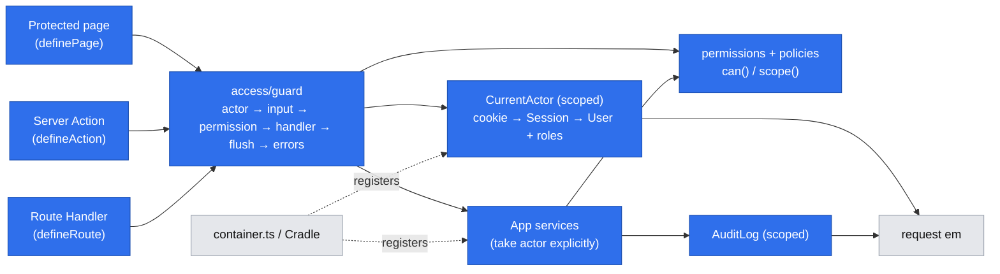
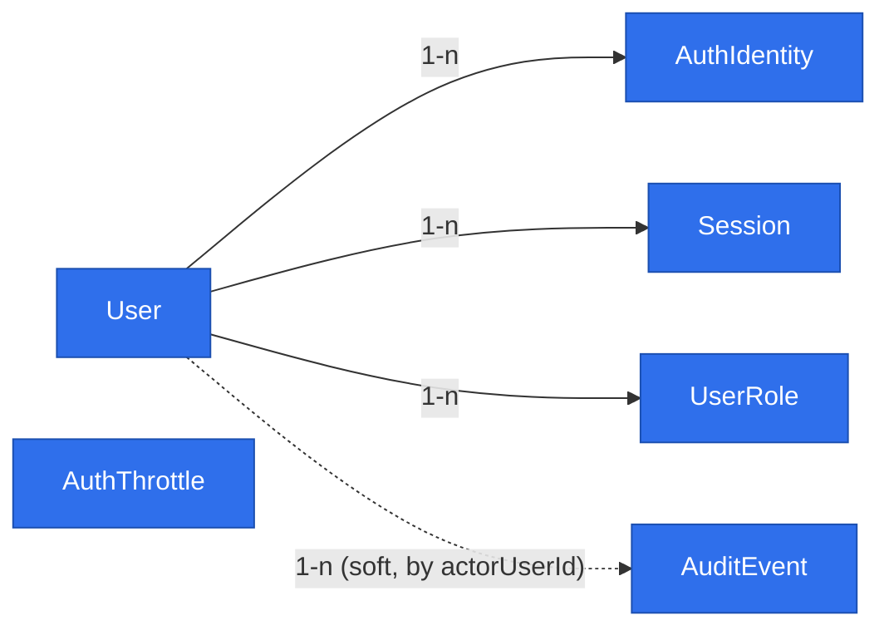

# Accounts and access (E01) and the access / entry-point primitives

Status: ready for review (post-review revisions applied)
Issues: #8 (E01), #13 (E01-S01), #14 (E01-S02)
Source: `.ai/specs/product-brief.md`, `.ai/specs/backlog.md`
Extends: `.ai/specs/implemented/2026-11-24-monorepo-foundation.md` (its step-3 follow-up "`/backend` authentication")
Follow-up spec (owed, Q6a): `domain-foundation` (Money, versioned operator settings, lifecycle helper, webhook idempotency), due before E02-S03

## 📝 TLDR

DevMentor has no accounts today: every page, including `/backend`, is public. **Proposed:** a
visitor signs in with GitHub or with email and password (D07/R06) and can sign out. Each user holds
a set of roles (everyone is a mentee; `mentor` comes from an invitation and `operator` from a CLI
grant), and every role reaches only its own pages and data (#13, #14). The change also delivers the
access layer that E02–E05 build on:
- a request-scoped **actor**;
- a **permission catalog** and **resource policies** (`can` / `scope`);
- **guarded entry points** (`defineAction`, `defineRoute`, `definePage`) that run every
  Server Action, Route Handler and protected page through the same checks;
- an **audit log**, an injectable **clock**, typed errors;
- the frontend side: the `ActionResult` form contract, Tailwind form primitives, a role-aware
  navigation registry, and 403/sign-in redirects.

## 📝 Problem Statement

- **#13 (E01-S01):**
  - GitHub sign-in lands the user signed in with their roles.
  - Email registration lets a user sign in.
  - Wrong credentials show an error and create no session.
  - After sign-out, protected pages redirect to sign-in.
- **#14 (E01-S02):**
  - A mentee is denied mentor and operator pages.
  - A mentor is denied *another mentor's* booking data. This is an ownership check, not a role
    check. **Moved to #20 (E03-S02)** (decision 1, 2026-11-27): there are no bookings in E01. This
    spec delivers the policy mechanism (`definePolicy` / `assertCan` / `scope`). #20 carries the
    end-to-end negative test.
  - An operator reaches operator pages.
- **Why the primitives belong in this spec.** About 15 stories in E02–E05 ask the same three
  questions: who is acting, may this role do this, and does this resource belong to them. Without
  one layer, each story hand-rolls the checks, and one missed ownership check is a data leak (former
  #14 AC2, now #20). Primitives below are limited to needs with a named consumer in the backlog:

  | Primitive (this spec) | Consumers in the backlog |
  |---|---|
  | Actor + session | every signed-in story |
  | Permission catalog (role gate) | E02-S01, E05-S01, E05-S02 (operator); E02-S02/S03/S04 (mentor) |
  | Resource policy `can` / `scope` | #20 (former #14 AC2), E03-S02/S03 bookings, E04-S01 session screen, E04-S02 note, E05-S02 dispute |
  | Role grant hook | E02-S01 invitation → `mentor` (R07: no open mentor registration); E01 CLI → `operator` (D19) |
  | Audit log | E01 role grants and account takeover; E02-S01 invites; E03-S03 mentor-cancel case; E05-S01 bounds/fee; E05-S02 decision |
  | Clock | E01 session expiry and throttle; R14 2-hour rule, R09 24-hour rule, D18 2-week window, R15 booking-to-start |
  | `defineAction` + `ActionResult` + form primitives | every form: register/sign-in now; profile, prices, slots, booking, cancel, note decision, dispute later |
  | `defineRoute` | `/api/health` and the GitHub callback now; Stripe webhooks and Checkout return later |

  Money, versioned settings, lifecycles and webhook idempotency have consumers too (E02-S03,
  E03-S02–S04, E04-S02, E05-S01–S03), but they are not access concerns. Per Q6a they get their own
  `domain-foundation` spec.

## 📝 User stories

**US1: A mentee registers with email and password.**
- **Who:** a working developer with no GitHub account at hand, e.g. on a work laptop.
- **Situation:** they want to look around and later book a mentor.
- **Wants:** an account without linking GitHub.
- **Sees:**
  - `/register` (name, email, password with the "at least 12 characters" hint), then `/account`
    with their name, email and "password" as the sign-in method;
  - the hint "Sign in with GitHub once to verify your email; mentor and operator roles need it";
  - in the header: Account and Sign out, no Mentor workspace or Operator.
- **System underneath:**
  1. Hits the `register:ip` bucket and normalizes the email.
  2. Hashes the password with argon2id.
  3. Creates `User` (unverified) and a password `AuthIdentity`, plus a `Session`.
  4. Flushes once, then sets `__Host-dm_session` and redirects to `/account`.
- **Next:** sign-out and sign-in with the same credentials. Later: the mentor list (E03-S01).
- **Delta:** Register and sign in · Duplicate email · Unverified account hint · Wrong password ·
  Repeated failures · Sign out · Mentee opens mentor and operator pages.

**US2: An invited mentor signs in with GitHub for the first time and reaches `/mentor`.**
- **Who:** a senior engineer the founders invited (R07).
- **Situation:** they hold an invitation. In E01 the founders grant the role with the CLI; from
  E02-S01 on, accepting the invitation grants it.
- **Wants:** to get to their mentor workspace with the account they already have.
- **Sees:**
  1. Opening `/mentor` while signed out redirects to `/sign-in?next=/mentor`.
  2. "Continue with GitHub" leads to GitHub authorization.
  3. Before the grant: the 403 page on `/mentor`. After the grant: the `/mentor` placeholder and
     "Mentor workspace" in the header, without signing in again.
- **System underneath:**
  1. Stores state and the PKCE verifier in short-lived cookies.
  2. The callback clears them, verifies state and exchanges the code.
  3. Reads the primary verified email. Rule 5 creates a verified `User` and a GitHub identity, or
     rule 1 signs in an existing one.
  4. After the grant, `RoleService.grant(mentor)` (verified account only) writes a `UserRole` and
     the audit event `role.granted`.
  5. The next request reads the roles again.
- **Next:** profile (E02-S02), prices and slots (E02-S03), Connect (E02-S04).
- **Delta:** First GitHub sign-in · Return to the protected page · Role takes effect without
  re-sign-in · Mentee opens mentor and operator pages (before the grant) · No verified email,
  cancelled or failed handshake · Email already linked to another GitHub account.

**US3: A founder becomes the operator and opens `/backend`.**
- **Who:** one of the two founders (D19).
- **Situation:** a fresh environment. `/backend`, public until now, is now closed.
- **Wants:** to reach the operator dashboard.
- **Sees:**
  - Opening `/backend` signed out redirects to sign-in. After signing in with GitHub, without the
    role: the 403 page.
  - After the grant: the dashboard with health badges and "Operator" in the header.
  - With a password-only account, the CLI answers "sign in with GitHub first".
- **System underneath:**
  - Sign-in follows US2.
  - On the server, the founder runs `npm run user:role -- grant --email … --role operator`. The
    CLI loads the user on a forked `em`, refuses unverified accounts, writes a `UserRole` and an
    audit event (`actorLabel = cli:<osUser>`), and exits 0.
  - `definePage({ access: "operator.backend" })` then lets them in.
- **Next:** operator stories E02-S01 (invitations) and E05.
- **Delta:** Anonymous visitor · Operator · Operator opens operator pages · Role refused for an
  unverified account.

## 📝 Proposed Solution

**Auth as our own module on small libraries (Q1a).**
- Arctic `OAuth2Client` handles GitHub OAuth (state + PKCE S256), with endpoints configurable so
  tests can point it at a fake server.
- `@node-rs/argon2` (argon2id) hashes passwords.
- **Database sessions** are MikroORM entities: an opaque random token in an httpOnly cookie, with
  only its SHA-256 hash stored.

Sessions are revocable and roles are read from the database on every request. A role granted by an
invitation or the CLI therefore takes effect on the next request without signing in again.
Authorization lives in the Data Access Layer, as the Next 16 auth guide recommends: every entry point
checks it.

**One rule for every entry point.** A Server Action, Route Handler or protected page exists only as
one of three things:
- `defineAction(...)`;
- `defineRoute(...)`;
- `definePage(...)` (for pages).

Each one declares its `access` explicitly (`"public"`, `"signed-in"` or a permission); there is no
default. An architecture unit test enforces this (see Testing).

**Alternatives that lost:**
- *Better Auth*: owns its own schema, outside our migrations.
- *Auth.js*: its credentials provider forces JWT sessions and discourages passwords.
- *JWT sessions*: not revocable, and roles go stale until the token expires.
- *`proxy.ts` optimistic redirects*: optional per the Next docs and a second place for auth logic.
  The page guards already meet #13 AC4. Proxy can be added later as a pure optimization.
- *Role checks scattered as `if (user.role === …)`*: the gap the policy layer closes.

## 📝 Architecture

Takeaway: every way into the server passes through one guard. Services receive the actor as an
argument and use `policy.scope()` for queries, so they never read cookies or roles themselves.

### Package placement (keeps the dependency direction)

| Package | New code |
|---|---|
| `core` | `errors.ts`: new `UnauthorizedError` 401, `ForbiddenError` 403, `ConflictError` 409, `RateLimitedError` 429; the existing `NotFoundError` 404 (used by `assertCan`) and `ValidationError` 400 stay. `clock.ts`: `Clock { now(): Date }`, `systemClock`, `fixedClock(date)` for tests. `action-result.ts`: `ActionResult<T>`, `ok()`, `fail()` (framework-agnostic types, shared by app and ui). `redirect-target.ts`: `safeRedirectPath(value, fallback)`, which rejects `//`, `/\`, absolute URLs and control characters (open-redirect guard). |
| `db` | Entities `User`, `AuthIdentity`, `Session`, `UserRole`, `AuditEvent`, `AuthThrottle` + one migration. Generic data helper `hashToken(token)` (sha-256 hex) in `helpers.ts`. No business rules here. |
| `app/src/server/auth/` | `password-hasher.ts` (argon2id behind a `PasswordHasher` interface), `session-service.ts`, `auth-cookies.ts` (the only module calling `cookies()`: the session cookie and the three OAuth transaction cookies), `github-oauth.ts` (uses `auth-cookies.ts`), `client-ip.ts` (see Throttle), `account-service.ts` (register / password sign-in / GitHub resolve-or-link), `throttle-service.ts`, `auth-config.ts` (env parsed once with zod). |
| `app/src/server/access/` | `actor.ts` (`Actor` type, `CurrentActor` scoped service), `roles.ts`, `permissions.ts` (catalog), `policy.ts` (`definePolicy`), `policies/user.ts`, `guard.ts` (`defineAction`, `defineRoute`, `definePage`, `requireActor`, `requirePermission`), `role-service.ts` (grant/revoke + audit), `audit-log.ts`. |
| `app/src/cli/` | `user-role.ts`: `npm run user:role -- grant\|revoke --email <e> --role mentor\|operator` (Q3a). |
| `app/src/app/` | `(frontend)/sign-in`, `(frontend)/register`, `(frontend)/account`, `(frontend)/mentor`, `api/auth/github/route.ts` (start), `api/auth/github/callback/route.ts`, `forbidden.tsx`, `(frontend)/_components/form/*`, `(frontend)/_components/site-header.tsx`, `src/navigation.ts`. `/backend` becomes operator-only. |

`next.config.ts` adds `experimental.authInterrupts: true` (needed by `forbidden()`) and adds
`@node-rs/argon2` to `serverExternalPackages` (native addon). New dependencies:
- `@devmentor/app`: `arctic`, `@node-rs/argon2`, `zod` (Q7a), plus `tsx` (runtime dependency, for the CLI).
- `@devmentor/core`: none.

### Actor and session

- `type Actor = { kind: "anonymous" } | { kind: "user"; userId; email; emailVerified; name; roleNames: readonly Role[]; permissions: ReadonlySet<Permission> }`.
  `type Role = "mentee" | "mentor" | "operator"`.
  - Every signed-in user has `mentee` implicitly. It is not stored (Q2a).
  - Only `mentor` and `operator` are stored, as `UserRole` rows.
  - `permissions` is computed once from the catalog when the actor is resolved. `roleNames` is for
    display only. Authorization code calls `hasPermission(actor, p)` and never branches on role
    names.
- `CurrentActor` (scoped) exposes `get(): Promise<Actor>`, memoized per request scope. It reads the
  session cookie and then makes **one** query: session ⋈ user ⋈ roles, filtered by
  `expiresAt > clock.now()`.
  - **It is read-only.** It neither writes cookies nor changes rows. It runs during Server Component
    render, where Next 16 forbids setting cookies (`cookies.md`, "Setting cookies is not supported
    during Server Component rendering"), and pages never flush.
  - An invalid, expired or unknown token returns anonymous.
  - The expiry is a fixed 30 days, with no sliding refresh. Expired rows of a user are deleted the
    next time that user signs in, which is a mutating path.
- Cookie `dm_session` (`__Host-dm_session` when secure): `httpOnly`, `sameSite=lax`, `path=/`,
  `maxAge` = session lifetime.
  - `secure` is on unless `APP_URL` is plain http on a loopback host (localhost / 127.0.0.1, which
    covers local dev and e2e).
  - With `NODE_ENV=production`, a non-loopback http `APP_URL` is a startup configuration error, so
    a misconfigured production cannot fall back to non-secure cookies.
  - A new token is created on every sign-in (no session fixation).
  - Sign-out deletes the row and the cookie.
  - Cookies are written only from Server Actions and Route Handlers, never from page render.
- Services never call `cookies()`. They take `actor` as a method argument from the guard, which
  keeps them unit-testable without Next mocks.

### Permission catalog and policies

- `permissions.ts` maps each role to the permissions it grants. E01 defines only what E01 uses:

  | Permission | Granted to | Used by |
  |---|---|---|
  | `account.self` | mentee (every user) | `/account`, sign-out |
  | `mentor.workspace` | mentor | `/mentor` (E02 pages extend it) |
  | `operator.backend` | operator | everything under `/backend` |

  Later specs add their permissions to this one file. `hasPermission(actor, permission)` is the
  only authorization check: `Actor` exposes no role set to branch on.
- `definePolicy<R>({ name, can(actor, action, resource): boolean, scope(actor, action): FilterQuery<R> | "none" })`.
  - Ownership checks for loaded resources go through `can`.
  - List queries go through `scope`, which merges the returned filter into the query. Services do
    not filter by owner by hand.
  - `assertCan(policy, actor, action, resource)` throws `NotFoundError` for a resource the actor may
    not see. It returns 404 rather than 403, so id probing cannot reveal that another mentor's
    booking exists.
  - E01 ships the `User` policy: `read` on self; operator reads anyone. `/account` loads the user
    through it, so the mechanism has a real consumer in E01.
  - Bookings, sessions, notes and disputes add their own policies in their specs. AGENTS.md
    (Phase 5) makes a negative test for every owned-resource policy mandatory.
  - `scope` gets its first list consumer in E03-S02. It is specified here so that every later
    resource follows one contract.

### Guarded entry points

- `defineAction({ access, input, handler })` returns `(prev: ActionResult<T>, formData: FormData) => Promise<ActionResult<T>>`,
  ready for `useActionState`. Order of steps:
  1. resolve the request container and actor;
  2. check access;
  3. parse `formData` with the zod `input` schema;
  4. run `handler({ input, actor, cradle })`, which returns `ActionOutcome<T> = { data: T } | { redirectTo: string }`;
  5. call `em.flush()` once (one transaction, so the change and its audit event commit together);
  6. then either `redirect(safeRedirectPath(redirectTo))` **after** the flush, or return `ok(data)`.

  Handlers never call `redirect()` themselves: a redirect thrown before the flush would drop the
  unit of work while the cookie is already set. A unit test pins this ("redirect after mutation
  persists", against a recording `em`).

  Error mapping. On any error the unit of work is **not** flushed: the action's business changes
  roll back as a whole.
  - `ZodError` → `fail("validation_error", fieldErrors)`.
  - `AppError` → `fail(code, message)`.
  - Next control-flow errors from `forbidden()` / `notFound()` are rethrown (`unstable_rethrow`).
  - Anything else is logged server-side and returned as `fail("internal_error", "Something went wrong")`,
    with no internal details.
  - An access failure in an action returns `fail("unauthorized" | "forbidden")`; the form shows a
    sign-in link.

  Writes that must survive a failed action, i.e. throttle counters, do not go through the unit of
  work. `ThrottleService` commits them immediately with one atomic statement (see Account flows).
- `defineRoute({ access, input?, handler })` does the same for Route Handlers. The handler returns
  either a `Response` (redirects, `Set-Cookie`, custom status and headers, e.g. `/api/health`'s
  503 and `no-store`) or plain data, which is serialized as JSON with status 200. An `AppError`
  maps to `{ error: { code, message } }` with its `status`. Webhooks later use `access: "public"`
  and verify signatures in the handler.
  - **Origin check.** For non-GET/HEAD requests whose `access` is not `"public"` (cookie-based
    access), `defineRoute` requires the `Origin` header to equal the origin of `APP_URL`. A
    missing or different `Origin` is refused before the handler runs with 403
    `{ error: { code: "bad_origin" } }`.
    - Server Actions already get this from Next.
    - `sameSite=lax` alone does not protect same-site subdomains or top-level POSTs.
    - E01 has no such route; the check is there for the first one, in E02+.
- `definePage({ access, returnTo? }, Page)` wraps every page's default export. It runs
  `requireActor` / `requirePermission` before rendering and passes `actor` to the page:
  - anonymous on a protected page → `redirect("/sign-in?next=" + safeRedirectPath(returnTo ?? pathname))`;
  - signed in but lacking the permission → `forbidden()` (403, `forbidden.tsx`).
  - Applied per **page**, not in the layout. Layouts do not re-run on client navigation, so a
    layout-only guard is not enough.
  - `requireActor` / `requirePermission` stay exported for Server Components nested inside a page.
- **Brand and architecture test.** `defineAction`, `defineRoute` and `definePage` results carry a
  `GUARDED` brand symbol. The architecture unit test (also listed under Testing) asserts:
  - every module under `src/app` with a `"use server"` directive (any file name) exports only
    branded functions;
  - every `route.ts` exports only branded HTTP-method handlers plus the allowlisted segment-config
    names (`dynamic`, `revalidate`, `runtime`, `maxDuration`, `fetchCache`, `preferredRegion`);
  - every `page.tsx` default export is branded;
  - inline `"use server"` functions inside components are rejected (grep). Actions live in modules;
  - no module except `server/auth/auth-cookies.ts` imports `cookies` from `next/headers`.

### Account flows

- **Register** (`(frontend)/register`, action `access: "public"`):
  - Fields: name (1–100 chars), email (normalized: trimmed and lower-cased), password (12–128 chars,
    no composition rules, per NIST 800-63B).
  - An existing email gives `ConflictError`: "An account with this email already exists. Sign in
    instead." Q4a has no email channel, so the existence of an email cannot be hidden here; sign-in
    stays generic.
  - On success: create `User` + password `AuthIdentity`, create a session, and return
    `{ redirectTo: next ?? "/account" }`.
  - Throttled per client IP: 10 registrations per hour (see below).
- **Password sign-in:**
  - Every failure gives the same message, "Email or password is incorrect", and no session.
  - When no user is found, the action still verifies against a dummy hash, so response time does
    not reveal which emails exist.
  - Throttle (`ThrottleService`, buckets in `AuthThrottle`). Each `hit(key, limit, window)` is one
    atomic `INSERT … ON CONFLICT (key) DO UPDATE … RETURNING` and commits immediately, so
    parallel requests cannot slip past the limit and a failed action cannot drop the count. The
    buckets:

    | Bucket | Limit |
    |---|---|
    | `signin:ip:<ip>` | 20 failures / 15 min |
    | `signin:email-ip:<email>:<ip>` | 5 failures / 15 min |
    | `signin:email:<email>` | 50 failures / hour; slows distributed guessing |
    | `register:ip:<ip>` | 10 / hour |

    - An exceeded bucket gives `RateLimitedError` ("Too many attempts, try again later") before the
      password is hashed, so the throttle also caps argon2 CPU load.
    - A successful sign-in clears the `email-ip` bucket.
    - A single attacker can no longer lock a user out (the tight limit is per email + IP). The broad
      per-email limit is the remaining lockout surface, and GitHub sign-in, which the founders use,
      is never throttled by it.
    - **Client IP** (`client-ip.ts`), set by `TRUSTED_PROXY_HOPS` (integer, default `0`):
      - The App Router does not expose the socket. Next's server fills `x-forwarded-for` with the
        socket address only when the request has no such header (`base-server.js`, `??=`).
      - The IP is read from `x-forwarded-for` **counting from the right**. With `h` trusted proxies,
        the client is the entry at position `h` from the right; each trusted proxy appends the peer
        it saw. With `h = 0`, the rightmost entry is used, which is the socket address that Next
        filled in. If there are fewer than `h` entries, the leftmost one is used.
      - Entries that a client prepends sit to the left of the trusted part and are never read.
    - `h = 0` is the dev/e2e setting: the socket address, with no shared fallback bucket. A client
      talking to the app directly could send its own header, so with `NODE_ENV=production`,
      `h = 0` together with a non-loopback `APP_URL` is a startup configuration error. This mirrors
      the secure-cookie rule.
- **GitHub sign-in:**
  - `GET /api/auth/github?next=…` (public) creates state and a PKCE verifier and stores them plus
    `next` in 10-minute cookies: httpOnly, `sameSite=lax` (strict would drop them on the
    cross-site return from GitHub), `path=/api/auth/github`. It then redirects to
    `{GITHUB_OAUTH_URL}/login/oauth/authorize` with scope `read:user user:email`.
  - `GET /api/auth/github/callback` always clears the three OAuth cookies first. It then checks
    state, exchanges the code, and fetches `/user` and `/user/emails`. It resolves the account in
    this order:
    1. A GitHub identity with that GitHub id exists → sign in as that user.
    2. No **primary verified** email → back to `/sign-in?error=github_no_verified_email`.
    3. The email matches a user who already has a GitHub identity with a different id → back to
       `/sign-in?error=github_conflict` ("This email belongs to an account linked to another
       GitHub account").
    4. The email matches a user **without a GitHub identity** (password-only, always unverified
       under Q4a): **GitHub claims the account**. In one flush this links GitHub, deletes the password identity, deletes all of
       that user's sessions, revokes every role it holds, marks the email verified, writes the
       audit event `account.claimed_by_github`, and shows a notice on `/account` ("Password sign-in
       was turned off because your email was never verified; use GitHub").
       - Revoking roles matters only if a future story grants roles to unverified accounts. In E01
         `RoleService` refuses that, so this is defence in depth.
    5. Otherwise → create a user with `emailVerifiedAt = now` and a GitHub identity.
  - Then create a session and redirect to `safeRedirectPath(next, "/account")`, after the flush.
  - A state mismatch, missing cookies or a GitHub error leads back to `/sign-in?error=github_failed`,
    with no session.
- **Sign-out:** a Server Action (`access: "signed-in"`, POST; Next checks the Origin of Server
  Actions). It deletes the session and redirects to `/`.
- **Password reset (Q4a): GitHub sign-in is the only recovery.**
  - A user who forgot their password signs in with a GitHub account whose verified primary email
    is the same. Rule 4 claims the account: password sign-in ends and GitHub becomes the sign-in
    method.
  - There is no CLI path and no reset screen. The earlier "operator deletes the password identity
    and the user registers again" path is dropped: the `User` row would remain, so registration
    would conflict.
  - Consequence (accepted under Q4a): a mentee without a GitHub account under that email cannot
    recover the account in 1.0. They can register under another address. Email verification and
    reset come with Q4b if this hurts.

### Roles, operator bootstrap, audit

- `RoleService.grant(userId, role, { by })` / `revoke(...)` is idempotent (granting twice is a
  no-op). Each change writes `role.granted` / `role.revoked` to the audit log.
  - `grant` **refuses an account whose email is unverified** (`ForbiddenError`
    "unverified_account"). Under Q4a only GitHub verifies an email. Otherwise someone who registers
    a founder's or an invited mentor's email first would receive the role.
  - Consequence (decision 2, 2026-11-27): **mentor and operator roles require at least one GitHub
    sign-in, and the password fallback applies to mentees only.** A role holder can never have a
    password identity:
    - only verified accounts receive roles;
    - only GitHub verifies an email (Q4a);
    - the GitHub claim (rule 4) deletes the password identity;
    - there is no set-password flow;
    - registering with a GitHub account's email conflicts.

    This is a **conscious partial deviation from D07**, which offers the email/password fallback to
    every role. See Decisions in play.
  - **Note for E02-S01 (invitations):** an invited mentor must sign in with GitHub before accepting.
    The acceptance step checks `actor.emailVerified`, and otherwise shows "Sign in with GitHub to
    accept this invitation" with the GitHub button (`next` set to the invitation link).
  - E02-S01 calls `grant(mentor)` when a mentor accepts an invitation.
  - The CLI calls it for operators (Q3a), with `by = { kind: "cli", osUser }`.
- CLI `npm run user:role -- grant --email a@b --role operator`:
  - Runs `tsx --conditions=react-server src/cli/user-role.ts`. The condition turns `server-only`
    into a no-op outside Next.
  - Uses `orm.em.fork()` and the same `RoleService` / `AuditLog`.
  - Exit code 1 with a message for an unknown email or role, or for an unverified account ("sign in
    with GitHub first"). The user must sign in with GitHub first.
  - `tsx` is a regular **dependency** of `@devmentor/app`, so the CLI also works on a production
    install (`npm ci --omit=dev`).
- `AuditLog.record({ actor, action, subject: { type, id }, data? })` persists an `AuditEvent` in the
  same unit of work as the change.
  - This is the in-product record of actions taken through the product.
  - R18's shared operator note stays the record for actions done **outside** the product. E05-S01
    may later add an operator view of the log.
  - No PII beyond ids goes into `data`; emails live on `User`.

## 📝 Data Model

All entities use `defineEntity` + `p`, are registered in `entities/index.ts`, and ship in one
migration (`--name accounts-and-access`) with the snapshot.

| Entity (table) | Fields | Constraints / notes |
|---|---|---|
| `User` (`user`) | `...baseProperties`, `email` text, `emailVerifiedAt` datetime?, `name` text | unique `email` (stored normalized). |
| `AuthIdentity` (`auth_identity`) | `...baseProperties`, `user` → User, `provider` enum `github \| password`, `subject` text (GitHub numeric id / normalized email), `secretHash` text? (argon2id PHC string, password only), `githubLogin` text? | unique (`provider`, `subject`); unique (`user`, `provider`); `on delete cascade` from user. |
| `Session` (`session`) | `id` text PK = sha-256(token) hex, `user` → User, `expiresAt` datetime, `createdAt` datetime | index `user`; cascade from user. No `baseProperties` (the PK is the token hash, and there is no `updatedAt` churn). |
| `UserRole` (`user_role`) | `...baseProperties`, `user` → User, `role` enum `mentor \| operator` | unique (`user`, `role`); cascade from user. `mentee` is implicit. |
| `AuditEvent` (`audit_event`) | `id` uuid, `createdAt`, `actorUserId` uuid? (null for CLI/system), `actorLabel` text (`user` / `cli:<osUser>` / `system`), `action` text, `subjectType` text, `subjectId` text, `data` jsonb? | Append-only, no FK to user (survives user deletion), index (`subjectType`, `subjectId`), index `createdAt`. |
| `AuthThrottle` (`auth_throttle`) | `key` text PK (e.g. `signin:email-ip:<email>:<ip>`), `count` int, `windowStartedAt` datetime | Written only via the atomic upsert, which resets the window when it has elapsed. A successful sign-in deletes its `email-ip` row. Stale rows are harmless. |

Sensitive data:
- Passwords exist only as argon2id hashes.
- Session tokens exist only as SHA-256 hashes; the raw token lives only in the cookie.
- GitHub access tokens are used once to read profile and emails and are **not stored**.
- No email addresses in audit `data` or logs.

No existing entities: the schema has only `baseProperties` today. `AuthThrottle` stands alone, with one
row per throttle bucket key (IP, email + IP, or email; see Account flows).

## 📝 API Contracts

| Entry | Access | Input (zod) | Result |
|---|---|---|---|
| `registerAction` | public | `name`, `email`, `password`, `next?` | redirect / `fail(validation_error \| conflict)` |
| `signInAction` | public | `email`, `password`, `next?` | redirect / `fail(invalid_credentials \| rate_limited \| validation_error)` |
| `signOutAction` | signed-in | — | redirect `/` |
| `GET /api/auth/github` | public | `next?` | 302 to GitHub; sets `dm_oauth_state`, `dm_oauth_verifier`, `dm_oauth_next` |
| `GET /api/auth/github/callback` | public | `code`, `state` | 302 to `next` or `/account`, or 302 `/sign-in?error=…` |
| `GET /api/health` | public | — | unchanged body; now built with `defineRoute` |

`ActionResult<T> = { ok: true; data: T } | { ok: false; error: { code: string; message: string; fieldErrors?: Record<string, string[]> } }`.

Env vars (in `.env.example`, server-only, loaded and validated by `auth-config.ts`):

| Variable | Notes |
|---|---|
| `APP_URL` | Default `http://localhost:3000`. Builds the redirect URI `${APP_URL}/api/auth/github/callback` and decides the `secure` cookie flag. |
| `GITHUB_CLIENT_ID`, `GITHUB_CLIENT_SECRET` | Optional. When missing, the GitHub button is hidden and the start route returns 404. Email and password still work, and `npm run setup` still yields a working app. |
| `GITHUB_OAUTH_URL` (default `https://github.com`), `GITHUB_API_URL` (default `https://api.github.com`) | Test overrides used by e2e. |
| `TRUSTED_PROXY_HOPS` | Default `0`. Number of reverse proxies in front of the app that append to `x-forwarded-for`. `0` with a non-loopback `APP_URL` under `NODE_ENV=production` is a startup error. |

## 📝 UI/UX

All signed-in mentor and mentee screens are **frontend** (Tailwind, Q5b). `/backend` (shadcn) is
operator-only.
- **Site header** (frontend, Server Component). It reads the navigation registry (`src/navigation.ts`:
  `{ href, label, access }[]`) filtered by `hasPermission(actor)`.
  Later epics add items to the registry instead of editing headers.
  - Anonymous: "Sign in" and "Register".
  - Signed in: "Account", "Mentor workspace" (mentor), "Operator" (operator → `/backend`), and a
    "Sign out" button form.
- **`/sign-in`:**
  - "Continue with GitHub" as the primary action (D07). It is a link to the start route and is
    hidden when GitHub is not configured.
  - A divider, then the email/password form.
  - The `?error=` codes map to human messages.
  - An already signed-in visitor is redirected to `/account`.
- **`/register`:** name, email, password, with "at least 12 characters" hint text.
- **`/account`** (`account.self`): name, email, sign-in methods (GitHub login / password), roles,
  and the GitHub-claim notice when it applies.
  - **Unverified-account hint** (password-only users): "Sign in with GitHub once to verify your
    email. Mentor and operator roles need it." It includes the GitHub button (`next=/account`),
    which is hidden when GitHub is not configured.
- **`/mentor`** (`mentor.workspace`): an empty workspace placeholder ("Profile, prices and slots
  come next", replaced by E02-S02).
- **`forbidden.tsx`:** "You don't have access to this page", with a link home. Status 403.
- **Frontend form primitives** (`(frontend)/_components/form/`, client, Tailwind only):
  - `ActionForm` wraps `useActionState(action, initial)`.
  - `Field`: label, input, `fieldErrors[name]` rendered with `aria-invalid` and
    `aria-describedby`.
  - `SubmitButton`: disabled while pending, via `useFormStatus`.
  - `FormMessage`: the top-level error, `role="alert"`.

  Backend shadcn form compositions (`input`, `label`, `form-field`) are **not** added now. The first
  operator form (E02-S01) adds them on the same `ActionResult` contract.

## 📝 Delta

### Capability: accounts

#### ADDED Requirement: Password registration and sign-in
The system SHALL let a visitor register with name, email and password and then sign in with them.

##### Scenario: Register and sign in
- WHEN a visitor registers with a new email and a 12+ character password, signs out, and signs in with the same credentials
- THEN they land on `/account` signed in, showing their name and email

##### Scenario: Duplicate email
- WHEN a visitor registers with an email that already has an account
- THEN registration is refused with "An account with this email already exists" and no user is created

##### Scenario: Unverified account hint
- WHEN a user who registered with email and password opens `/account`
- THEN they see "Sign in with GitHub once to verify your email. Mentor and operator roles need it."

#### ADDED Requirement: Wrong credentials create no session
The system SHALL reject wrong credentials with one generic message and SHALL NOT create a session.

##### Scenario: Wrong password
- WHEN a visitor submits a registered email with a wrong password
- THEN "Email or password is incorrect" is shown and `/account` still redirects to sign-in

##### Scenario: Repeated failures
- WHEN the same email fails sign-in 5 times within 15 minutes from the same client
- THEN further attempts from that client, even with the correct password, are refused with a retry message until the window ends, while GitHub sign-in for that account still works

##### Scenario: Spoofed X-Forwarded-For does not reset the limit
- WHEN a client behind the trusted proxy sends a different fake `x-forwarded-for` value on every failed attempt
- THEN the limit still applies to that client after 5 failures

#### ADDED Requirement: GitHub sign-in
The system SHALL let a visitor sign in with GitHub and land signed in with their roles.

##### Scenario: First GitHub sign-in
- WHEN a visitor authorizes GitHub with a primary verified email that is unknown to DevMentor
- THEN an account is created and they land on `/account` signed in

##### Scenario: GitHub claims an unverified password account
- WHEN GitHub returns a verified email equal to that of a password-only account
- THEN the visitor is signed in to that account, password sign-in for it stops working, its other sessions end, and `/account` explains why

##### Scenario: No verified email, cancelled or failed handshake
- WHEN GitHub has no primary verified email, the visitor cancels on GitHub, or the state check fails
- THEN the visitor is back on `/sign-in` with a message for that case and no session exists

##### Scenario: Email already linked to another GitHub account
- WHEN GitHub returns a verified email that belongs to an account linked to a different GitHub id
- THEN sign-in is refused with "linked to another GitHub account" and the existing link is unchanged

#### ADDED Requirement: Sign-out
The system SHALL end the session on sign-out, after which protected pages redirect to sign-in.

##### Scenario: Sign out
- WHEN a signed-in user signs out and then opens `/account`
- THEN they are redirected to `/sign-in?next=/account`

#### ADDED Requirement: Safe return after sign-in
The system SHALL return a user to the page that sent them to sign-in, and only to a path inside
DevMentor. An already signed-in visitor opening `/sign-in` or `/register` SHALL go to `/account`.

##### Scenario: Return to the protected page
- WHEN an anonymous visitor opens `/mentor`, is redirected to sign-in, and signs in with GitHub as a mentor
- THEN they land on `/mentor`

##### Scenario: Hostile return target
- WHEN sign-in is opened with `next=//evil.example` or `next=https://evil.example`
- THEN after signing in the user lands on `/account`

##### Scenario: Already signed in
- WHEN a signed-in user opens `/sign-in`
- THEN they are redirected to `/account`

### Capability: access-control

#### ADDED Requirement: Role areas
The system SHALL show each area only to roles holding its permission: `/account` to every signed-in
user, `/mentor` to mentors, `/backend` to operators.

##### Scenario: Mentee opens mentor and operator pages
- WHEN a user without roles opens `/mentor` or `/backend`
- THEN they see the 403 page, and the header shows neither "Mentor workspace" nor "Operator"

##### Scenario: Operator opens operator pages
- WHEN a user granted `operator` through the CLI opens `/backend`
- THEN the dashboard renders

##### Scenario: Role refused for an unverified account
- WHEN the CLI grants a role to an account that only ever registered with email and password
- THEN the CLI exits with "sign in with GitHub first" and the account gains no role

##### Scenario: Role takes effect without re-sign-in
- WHEN a signed-in user is granted `mentor`
- THEN their next request to `/mentor` succeeds

#### ADDED Requirement: Owned resources are invisible to non-owners
The system SHALL answer a request for a resource the actor may not see exactly as for a missing
resource (404).

##### Scenario: Another user's resource
- WHEN an actor requests a resource whose policy denies them
- THEN the response is "not found" and no field of the resource is returned

Note: in E01 this scenario is verified by unit tests on `definePolicy` / `assertCan` and the `User`
policy. No owned resource has an id-addressed page yet. #14 AC2 ("another mentor's booking data")
**moved to #20 (E03-S02)** by decision 1. Its end-to-end negative test ships with that story, and
#14 closes without it.

#### ADDED Requirement: Backend dashboard is operator-only
The system SHALL render the `/backend` dashboard only for operators. Anonymous visitors are
redirected to `/sign-in?next=/backend`; signed-in non-operators get 403.

##### Scenario: Anonymous visitor
- WHEN an anonymous visitor opens `/backend`
- THEN they are redirected to `/sign-in?next=/backend`

##### Scenario: Operator
- WHEN an operator opens `/backend`
- THEN the dashboard shows the health badges and "Raw JSON" links to `/api/health`

No capability file records today's public `/backend`; its only pin is
`packages/e2e/tests/backend.e2e.ts`, which Phase 4 rewrites to these scenarios. So the requirement
is ADDED, not MODIFIED.

## 📝 Testing

- **Unit (100%):**
  - core helpers (`safeRedirectPath` table of hostile inputs, clocks, errors, `ActionResult`);
  - guard: every branch of the error mapping, access modes, flush-once, rethrow of Next control
    flow;
  - `CurrentActor`: valid, expired and unknown cases with `fixedClock`; asserts no write and no cookie set;
  - `AccountService`: all five GitHub resolution branches, register conflict, dummy-hash path,
    throttle window and lock;
  - `RoleService` idempotency + audit; `definePolicy` / `assertCan` / `scope`; CLI argument parsing
    and exit codes;
  - pages with `vi.mock("@/server/…")`.
- **Architecture tests** (unit): exactly the five assertions listed under "Brand and architecture
  test" in Guarded entry points:
  - every `"use server"` module exports only branded functions;
  - every `route.ts` exports only branded handlers plus allowlisted segment config;
  - every `page.tsx` default export is branded;
  - no inline `"use server"`;
  - `cookies` imported only by `server/auth/auth-cookies.ts`.
- **Integration:** `tests/auth.e2e.ts` and `tests/access.e2e.ts` cover every Delta scenario except
  the throttle (unit-level, with a recording `em`, plus integration tests in `tests/auth.e2e.ts`
  of the real upsert SQL and of "Spoofed X-Forwarded-For does not reset the limit") and "Another
  user's resource" (unit only in E01, see its note).
  - **Forwarding proxy** `packages/e2e/src/forwarding-proxy.ts` (`node:http`): e2e runs the app
    behind it with `TRUSTED_PROXY_HOPS=1`, the production topology. Like a real proxy, it appends
    the peer address to `x-forwarded-for`.
    - Test-only: when the request carries `x-e2e-client-ip`, it appends that value instead. Each
      `Browser` session sets its own value (`agent-browser set headers`), so test files do not
      share throttle buckets, even though every connection comes from 127.0.0.1.
    - The spoof test sends rotating fake `x-forwarded-for` values with one fixed `x-e2e-client-ip`
      and expects the limit after 5 failures.
  - Unit: `client-ip` for `h = 0/1/2`, too few entries, prepended spoofed entries, and the
    production startup error; `defineRoute` Origin check (match, mismatch, missing, GET exempt,
    public exempt).
  - `packages/e2e/src/fake-github.ts` is a tiny `node:http` OAuth server (authorize → code, token,
    `/user`, `/user/emails`). It holds **no shared per-test state**: its authorize page lists
    the fixture profiles as buttons, and the test clicks one, which encodes the chosen profile into
    the code. Parallel test files and browser sessions cannot race.
  - `global-setup.ts` starts the fake server **before** `startAppServer`. `app-server.ts` picks
    the app port first and passes `APP_URL=http://127.0.0.1:<port>` plus `GITHUB_*` pointing at the
    fake server.
  - Roles come from `npm run user:role` against the e2e database. This is the product's own CLI, so
    the tests stay black-box.

## 📝 Edge Cases & Failure Scenarios

| Case | Behavior |
|---|---|
| GitHub is down or returns an error during the token exchange or profile fetch | `/sign-in?error=github_failed` ("GitHub sign-in failed, try again or use email"); logged without tokens. |
| GitHub env missing | The GitHub button is hidden and the start route returns 404; email and password still work. |
| The user denies GitHub authorization | GitHub sends `error=access_denied` → `/sign-in?error=github_cancelled`. |
| Hostile `next` (`//evil.com`, `https://…`, `/\evil`) | `safeRedirectPath` falls back to `/account`. |
| Spoofed `x-forwarded-for` | Only the trusted right-hand part is read (`TRUSTED_PROXY_HOPS`), so prepended values change nothing. A misconfigured hop count is caught for `0` only (startup error); a too-high value lets clients pick their IP, which is a deployment concern. |
| Forgotten password, no GitHub account under that email | No recovery in 1.0 (Q4a); register under another address. |
| Session row deleted (sign-out elsewhere, GitHub claim) | The next request is anonymous; the page redirects to sign-in; a stale action form returns `unauthorized` with a sign-in link. |
| Role revoked mid-session | The next request loses the area (roles are read on every request). |
| Database down | Guards fail closed: the actor cannot be resolved → 500 error page, never a public render of a protected page. |
| Two GitHub accounts with the same verified email | Rule 3: the second one is refused with `github_conflict`; the first stays linked. |
| Argon2 cost | Default argon2id params (m=19456, t=2, p=1, the OWASP minimum) keep a hash around 50 ms; the throttle bounds abuse. |
| `authInterrupts` is experimental | If removed upstream, `requirePermission` switches to rendering the 403 page itself; the change is local to `guard.ts`. |

## 📝 Risks & Impact Review

- **Hard to reverse:**
  - The session cookie name and the hash-as-PK session table.
  - The `AuthIdentity` shape, which later providers would reuse.
  - The rule that GitHub claims unverified accounts. If email verification arrives later, rule 4
    is replaced by "link only after verifying". Existing data still fits.
- **Behavior change for anyone using `/backend` today:** it now needs an operator account. The
  founders run `npm run user:role -- grant --email … --role operator` once per environment.
  `npm run setup` output mentions it.
- **Q4a trade-off (accepted):**
  - Registration reveals whether an email has an account.
  - There is no self-service password reset.
  - A person who registered with someone else's email loses that account as soon as the real owner
    signs in with GitHub. This is intended.
- **Decision 1 (approved 2026-11-27): #14 AC2 moves to #20 (E03-S02).** #20 gains the AC "Given a
  mentor, when they open another mentor's booking, then the response is 404 (moved from #14 AC2)".
  When this spec ships, #14 closes with AC1 and AC3 verified end to end, and AC2 is recorded as
  moved, not done. The tracker edits are drafted and posted only after review.
- **New dependencies:** `arctic`, `@node-rs/argon2` (native, prebuilt binaries for linux/macos/win),
  `zod`, `tsx` (runtime dependency of app, for the CLI). None replaces a fixed stack choice.
- **Client IP trust:** the throttle reads `x-forwarded-for` from the right, per
  `TRUSTED_PROXY_HOPS`. The deployment must set it to the real number of appending proxies. Too
  high a value lets clients choose their bucket; the per-email buckets remain the backstop.

## 📝 Decisions in play

- D07 / R06: GitHub for every role, email and password as the fallback (founder A). **Partly
  deviated, consciously (decision 2, approved in spec review 2026-11-27):**
  - GitHub works for every role.
  - The email/password fallback applies to **mentees only**: mentor and operator roles require at
    least one GitHub sign-in, and role holders never have a password identity.
  - Reason: Q4a has no email verification, so only GitHub proves email ownership before privileges
    are granted.
  - D07's owner (founder A) confirms this or records a superseding note.
- R07 / D08: mentors by invitation. E01 provides `RoleService.grant`; there is no mentor
  self-registration.
- D19 / R18: the operator is the founders. Operator role via CLI with audit; manual actions outside
  the product stay in the shared note.
- N01, N02, D26: untouched. No video, no ratings; no ownership checks on shared material.
- No decision is superseded; D07 is narrowed as above.

## 📋 Phasing

1. **Phase 1 – Entry-point primitives** (no behavior change).
2. **Phase 2 – Password accounts** (#13 AC2–AC4).
3. **Phase 3 – GitHub sign-in** (#13 AC1).
4. **Phase 4 – Roles and areas** (#14 AC1, AC3; AC2 moved to #20).
5. **Phase 5 – Docs and archive.**

Each phase ships on its own and keeps the app working.

## 📋 Implementation Plan

### Phase 1 – Entry-point primitives
1. `core`: new errors, `Clock`, `ActionResult`, `safeRedirectPath`, with tests. Export entry points
   (`@devmentor/core/clock`, `/action-result`, `/redirect-target`).
2. Add `zod` to the app. Add `access/actor.ts` with anonymous-only `CurrentActor`, `permissions.ts`
   (empty catalog), and `guard.ts` (`defineAction`, `defineRoute`, `requireActor`,
   `requirePermission`, brand, Origin check for non-GET cookie-access routes; `definePage` arrives in step 6). Register `clock` (singleton) and `currentActor` (scoped) in `Cradle`.
   Unit tests.
3. Move `/api/health` to `defineRoute({ access: "public" })`. Add the architecture test. Existing
   e2e stays green.

### Phase 2 – Password accounts
4. `db`: entities `User`, `AuthIdentity`, `Session`, `UserRole`, `AuditEvent`, `AuthThrottle`;
   `hashToken`; generate and review the migration + snapshot; tests.
5. `server/auth`: `PasswordHasher` (argon2id, `serverExternalPackages`), `SessionService` +
   `auth-cookies`, `client-ip`, `ThrottleService`, `AccountService` (register, password sign-in). `CurrentActor`
   reads real sessions. `AuditLog`. Unit tests with fake `em` and `fixedClock`.
6. Frontend form primitives, the site header with the navigation registry, `/register`, `/sign-in`
   (email form), `/account` via `definePage({ access: "account.self" })` (the catalog gets
   `account.self` in this step), sign-out action, `definePage` + page brand test. Page tests.
7. `packages/e2e/src/forwarding-proxy.ts`; the app runs behind it with `TRUSTED_PROXY_HOPS=1`;
   `Browser` sets a per-session `x-e2e-client-ip`. `tests/auth.e2e.ts`: register → sign out → sign
   in; unverified-account hint; wrong password; sign-out redirect; throttle; spoofed
   `x-forwarded-for`.

### Phase 3 – GitHub sign-in
8. `auth-config.ts` + `.env.example`. `github-oauth.ts` on Arctic `OAuth2Client`. The
   `AccountService.resolveGithub` five-rule resolution with audit for claims. Start and callback
   routes via `defineRoute`. Unit tests for every branch.
9. `packages/e2e/src/fake-github.ts` (profile picker, stateless), started in `global-setup.ts`
   before the app. `app-server.ts` passes `APP_URL` and `GITHUB_*`. Extend `auth.e2e.ts` with:
   first sign-in, claim of an unverified account, no verified email, cancelled authorization,
   `github_conflict`, hostile `next`.

### Phase 4 – Roles and areas
10. `RoleService` + audit; CLI `user-role.ts` + `npm run user:role` (tsx `--conditions=react-server`);
    full permission catalog; `definePolicy`, `assertCan`, `User` policy; `authInterrupts` +
    `forbidden.tsx`; `/mentor` placeholder; `/backend` layout and page guarded by
    `operator.backend`; role-aware header items. `RoleService` refuses unverified accounts. Unit tests.
11. Rewrite `backend.e2e.ts` to the "Backend dashboard is operator-only" scenarios (anonymous redirect; operator
    signs in after `user:role grant`). Add `tests/access.e2e.ts`: mentee 403 on `/mentor` and
    `/backend`; mentor reaches `/mentor` without re-sign-in; operator reaches `/backend`.

### Phase 5 – Docs and archive
12. AGENTS.md: a new "Access & entry points" subsection with these rules:
    - every action and route goes through `defineAction` / `defineRoute`;
    - every page's default export goes through `definePage`;
    - services take `actor` and use `policy.scope`;
    - new permissions go in `permissions.ts`;
    - owned resources need a policy with a negative test;
    - document `npm run user:role` and the new env vars.

    Update `developer-setup` if the setup output changes.
13. **Archive the Delta** into `.ai/specs/capabilities/accounts.md` and
    `.ai/specs/capabilities/access-control.md`. Move this spec to `implemented/`. Add a lesson for
    any pitfall found (e.g. `server-only` under tsx).
